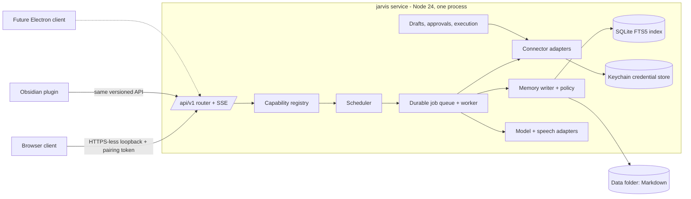

# Jarvis architecture

Jarvis is one local service with two thin clients.
The service owns memory writes, credentials, tool authority, durable jobs, scheduling and action execution.
The browser client and the Obsidian plugin render state and submit requests; neither writes memory or schedules work.



## Stack and why

| Concern | Choice | Reason |
| --- | --- | --- |
| Runtime | Node.js 24 LTS, bundled in the release artifact | Its built-in `node:sqlite` ships SQLite 3.53 with FTS5, so there is no native addon to rebuild per platform. Node 22.14 lacks FTS5 (verified). One language across service, web and plugin. |
| Service HTTP | `node:http` with a small router and server-sent events | Few moving parts; SSE gives ordered, resumable events with `Last-Event-ID`. |
| Contracts | `zod` schemas in `packages/contracts` | Shared by service, web and plugin; validated at the server boundary. |
| State | One SQLite database in the service state directory | Jobs, events, approvals, attention decisions, conversations, connection state. WAL mode. |
| Knowledge | Markdown files in the user's chosen data folder | Human-readable, Obsidian-compatible; the FTS index is rebuildable from the files. |
| Web client | React + Vite, `markdown-it` with raw HTML disabled | Small, well-known; imported Markdown cannot inject HTML or `javascript:` links. |
| Obsidian | Official plugin API, `ItemView`, `requestUrl`, `SecretStorage` | Desktop-only thin client over the same API. |
| Secrets | macOS Keychain via `/usr/bin/security -i` (values on stdin, never argv); 0600 file fallback off macOS | Outside the vault and outside frontend storage. |
| Install | Self-extracting installer bundling Node, the service bundle, web assets, launchd agent | One command/double-click; no developer tools required. |

## Data layout

Data folder (user-chosen, Markdown):

```
<data folder>/
  README.md                 what each area is for
  memory/                   curated memory (recalled as knowledge)
    people/ projects/ decisions/ notes/
    self.md                 identity record (protected)
  evidence/                 archived evidence, never presented as curated fact
    captures/ conversations/ connectors/
  deliverables/             generated work products (briefings, research, drafts)
```

Imported folders stay where they are.
The import preview lists what will be read, what is skipped and that zero files in the source folder change.
Imported files are indexed read-only as area `import` and cited by their real path and line range.

Service state (`~/Library/Application Support/Jarvis/state`): `jarvis.sqlite`, logs, runtime metadata, backups, downloaded speech models.
Credentials: Keychain service `dev.jarvis.<instance>`.

## Memory model

Every memory note has frontmatter (`id`, `type`, `title`, `provenance`, `sources`, `created`, `updated`), a `## Current State` section with one dated entry per subject, optional `## Notes`, and an append-only `## History`.
A correction replaces the Current State entry and appends the superseded value, its date, source and the reason to History.
This is the state-versus-event rule from the old vault's 2026-08-13 repair, enforced by the writer rather than by instructions.

Write policy (deterministic, in `memory/policy.ts`):
- Only the service writes. Clients submit captures and corrections through the API.
- `memory/self.md` (identity) and authorization records (connection write permissions, stored in the database) change only through explicit user-authenticated settings endpoints; model output, imports and connector data can never write them.
- Model output never writes memory directly. Suggested memory changes are stored as proposals that the user applies or rejects.
- Writes are atomic (temp file + rename) under a per-path in-process lock; one service process owns the folder (a lock file with the owner pid prevents a second writer).
- Paths are resolved and confined to the data folder; symlinks out of it are refused.

## Retrieval

Chunks are Markdown sections with exact line ranges.
Each chunk is labelled `state`, `history` or `body`; History chunks are down-weighted and presented to the model as superseded.
Queries are tokenised and every term is quoted before FTS5 `MATCH`, blocking operator injection.
Ranking uses BM25 with column weights (title 6, heading 3, text 1), fused by reciprocal rank with a prefix-match list (`k = 60`), then adjusted: curated memory above imports, imports above evidence, current state above history.
The index is updated synchronously on every write and by a file watcher/rescan for edits made in Obsidian, fixing the new build's unscheduled indexer (four weeks stale when inspected).
Vector search is deliberately not in this release: no embedding model is guaranteed on a clean install, and lexical recall with exact citations is verifiable.

Answers: the service retrieves first, numbers the evidence `[S1]..[Sn]`, sends it to the model as quoted data with an instruction that documents are untrusted, and maps cited markers back to exact file and line ranges.
When nothing relevant is retrieved the answer is marked unsupported and the model is told to say so.
Without a model, chat returns the retrieved evidence directly and says no model is connected.

## Attention and briefings

The attention engine follows these rules:
- Item identity (`key`) is separate from change detection (`fingerprint`). Fingerprints are SHA-256 over length-prefixed parts, truncated to 16 hex characters, so a separator cannot forge a collision.
- Keys use the work item identity (for example `jira:ISSUE-1`), and the category (due, overdue) goes in the fingerprint, fixing the due→overdue key churn.
- Transport-dependent fields (`updated_at`) are not fingerprint parts.
- An item is resolved only if its source was fully covered in this and the previous run.
- A dismissal records the fingerprint it applied to. Unchanged items stay dismissed; a changed fingerprint reopens the item with the reason.
- Snooze stores an absolute time and reopens only after it passes.
- Coverage per source per run is one of `complete`, `partial` (pagination stopped, rate limit, page cap), `denied` (scope/403), `unauthorized` (401/expired), `offline` (network), `error`, `not_configured`. A zero from a partial source is never shown as "nothing to do".
- Gmail read state is derived from `labelIds`, never inferred. A thread whose last message is from the user is never awaiting reply. All-day events are detected from their midnight-to-midnight shape. Calendar notification mails are excluded from pending replies.

## Jobs, scheduler and recovery

- A job row is committed before the API acknowledges it. Every progress step writes an ordered `job_events` row; clients reconnect with `Last-Event-ID` and receive every missed event plus retained results.
- The worker leases a job with an expiry. On service start, jobs with an expired lease are recovered from their last checkpoint.
- External side effects go through an outbox keyed by an idempotency key. The key is recorded as `pending` before the call and `done` with the verified result after it. A recovered job that finds `done` reuses the result; one that finds `pending` verifies with the remote before retrying, so a restart cannot double-post.
- Cancellation sets `cancel_requested_at`. The response and the job record state whether the work stopped (`stopped`) or the request arrived after completion (`too_late`).
- The scheduler lives in the service. Schedules are rows with `next_run_at`. A tick every 15 s runs due schedules; if the gap between ticks exceeds twice the interval (the Mac slept), missed runs are coalesced into one catch-up run instead of replaying every missed interval. Offline sources simply record `offline` coverage and are retried next tick.
- Browser tabs and service workers never schedule work.

## Drafts, approvals and execution

- A draft is an action record: kind, connection, target, payload, `payload_hash` (SHA-256 of canonical JSON), `version`, context/evidence, `expires_at`.
- Editing a draft increments `version` and changes the hash, invalidating any approval.
- Approval creates `{actionId, version, payloadHash, nonce, expiresAt, approvedBy}`.
- Execution requires the approval; the server rechecks, immediately before calling the adapter: action status, version, hash, nonce unused (atomically consumed), approval and action expiry, feature enabled, connection connected and the write action authorized for that connection.
- Status becomes `succeeded` only when the adapter returns a verified remote id (followed by a read-back where the API allows). Otherwise `failed` with the error, or `unknown` if the call timed out after sending.
- Receipts and every attempt are stored in `action_events`.
- Revoking an approval, disabling write authority or disconnecting prevents later execution.
- Expiry uses 48 business hours (weekends skipped); refreshing a draft keeps its original `created`.

## Security

- The service binds `127.0.0.1` only. The `Host` header must be the loopback address with the service port (prevents DNS rebinding).
- Clients pair: the installer or Settings issues a short-lived single-use pairing code; exchanging it yields a random token (stored hashed). The browser gets an `HttpOnly; SameSite=Strict` cookie; Obsidian stores its token in Obsidian `SecretStorage`.
- `Origin` must be the service origin or `app://obsidian.md`. State-changing requests also require `X-Jarvis-Client: 1`, which cross-site forms cannot send.
- Logs, evidence and API responses pass through redaction of known secret values and token patterns.
- Imported and connector content is data: it is rendered with raw HTML disabled, and it is quoted inside the model prompt with an instruction not to follow embedded instructions. The conversation model has no tools, so injected text cannot trigger actions.

## Capability registry

`capabilities/registry.ts` is the single definition of features (conversation, recall, capture, attention, drafts, jobs, voice) and connections, with their dependencies, required scopes, schedules and job kinds.
The setup checklist, dependency validation, API access checks (`requireFeature`) and scheduler all read it.
Disabling a feature disables its schedules, rejects its endpoints with `feature_disabled`, and cancels its queued jobs.
Disconnecting a connection deletes its credentials, stops new requests, cancels queued jobs that depend on it, revokes pending approvals targeting it, and offers to keep or delete its retained observations.

## Clients

- Browser: React. Home combines the attention inbox and a persistent conversation; Memory, People, Projects, Decisions, Drafts, Jobs, Connections and Settings are views linked to it.
- Obsidian: a desktop plugin with a Jarvis view (attention + ask), settings (service URL, pairing), and commands (ask about current note, capture selection with provenance, open attention). It uses the same API and never writes memory itself.
- Electron: not in this release. The API is versioned (`/api/v1`) and has no browser-only assumptions, so an Electron shell can load the same web client.

## What was reused and what inspired the design

See `docs/inspection.md` for the evidence behind each item.
