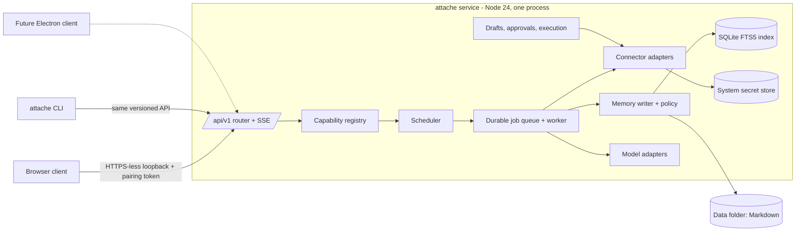

# Attache architecture

Attache is one local service with a thin browser client and a command line.
The service owns memory writes, credentials, tool authority, durable jobs, scheduling and action execution.
The browser client and the CLI render state and submit requests; neither writes memory or schedules work.



## Stack and why

| Concern | Choice | Reason |
| --- | --- | --- |
| Runtime | Node.js 24 LTS, bundled in the release artifact | Its built-in `node:sqlite` ships SQLite 3.53 with FTS5, so there is no native addon to rebuild per platform. Node 22.14 lacks FTS5 (verified). One language across service, web and plugin. |
| Service HTTP | `node:http` with a small router and server-sent events | Few moving parts; SSE gives ordered, resumable events with `Last-Event-ID`. |
| Contracts | `zod` schemas in `packages/contracts` | Shared by service, web and plugin; validated at the server boundary. |
| State | One SQLite database in the service state directory | Jobs, events, approvals, attention decisions, connection state. WAL mode. |
| Knowledge | Markdown files in the user's chosen data folder | Human-readable, Obsidian-compatible; the FTS index is rebuildable from the files. |
| Dashboard | React + Vite, `markdown-it` with raw HTML disabled | Small, well-known; imported Markdown cannot inject HTML or `javascript:` links. |
| Secrets | The operating system's secret store behind one interface: the macOS Keychain via `/usr/bin/security -i`, the Linux Secret Service via libsecret's `secret-tool`, Windows Credential Manager via Windows PowerShell (values on stdin and stdout, never argv); a private file (0600, or an owner-only access-control list on Windows) where none works | Outside the vault and outside frontend storage. |
| Remote sources | GitHub REST; Jira and Confluence through the Atlassian Rovo MCP server; Slack, Gmail and Calendar through the user's claude.ai connectors | Atlassian's MCP server and the organization's claude.ai connectors are the supported, admin-governed access paths, so no per-user Slack app or Google Cloud OAuth client is needed. The MCP client is about 200 lines because Attache needs only initialize, tools/call and its own OAuth flow on the existing loopback callback; the Claude Code control protocol is driven directly so the argument-level approval gate stays in Attache's code. |
| Install | Self-extracting installer bundling Node, the service bundle and web assets; the bundled `attache` sets up the background service and command-line wrappers | One command/double-click; no developer tools required. |

## Data layout

Data folder (user-chosen, Markdown):

```
<data folder>/
  README.md                 what each area is for
  memory/                   curated memory (recalled as knowledge)
    people/ projects/ decisions/ notes/
    self.md                 identity record (protected)
  evidence/                 archived evidence, never presented as curated fact
    captures/                captures, such as meeting notes and transcripts (a new one tagged as a meeting is consolidated)
    conversations/           chat archives from versions that had a chat (kept, never quoted by recall)
    connectors/<kind>/       connector snapshots, one file per day per Machine
    sessions/                Harness session logs, one file per day per Machine (searchable)
      transcripts/<agent>/   redacted session transcripts (archived, never quoted by recall)
    wrap-ups/                durable points of Harness conversations, from the wrap-up prompt (searchable)
  deliverables/             generated work products (briefings, research, drafts), one file each, named with the day and the Machine
  review/                   review state, one JSON file per item, never indexed for recall
    inbox/                   inbox items with the owner's latest decision
    proposals/               Proposals with every decision made on them
```

Imported folders stay where they are.
The import preview lists what will be read, what is skipped and that zero files in the source folder change.
Imported files are indexed read-only as area `import` and cited by their real path and line range.

Service state (`~/Library/Application Support/Attache/state` on macOS, `~/.local/state/attache` on Linux): `attache.sqlite`, logs, runtime metadata, backups.
Writer locks (`~/Library/Application Support/Attache/locks`, `~/.local/state/attache/locks` on Linux, `%LOCALAPPDATA%\Attache\locks` on Windows, `ATTACHE_LOCK_DIR` in tests): one file per data folder in use, named by a hash of the folder's real path.
Credentials: Keychain service `dev.attache.<instance>` on macOS; Secret Service items with attributes `service=dev.attache.<instance>` and `account=<key>` on Linux; generic credentials with the target `dev.attache.<instance>/<key>` (persisted for this computer, not roamed; values over 2,560 bytes continue in `<target>#2`, `#3` and so on) on Windows.
The system stores keep an index of key names (never values) in the state folder, because they cannot be listed safely.

## Platform modules

Everything that differs between macOS, Linux and Windows lives in `apps/service/src/platform/`, so the rest of the service never calls an operating-system tool or hard-codes an operating-system path.

| Module | Interface | macOS | Linux | Windows |
| --- | --- | --- | --- | --- |
| `service-manager/` | `ServiceManager`: install, start, stop, uninstall, loaded | launchd agent `dev.attache.<instance>` | systemd user service `attache-<instance>.service` (`attache.service` by default) | Task Scheduler logon task `Attache-<instance>` (`Attache` by default) |
| `secret-store/` | `SecretStore`: get, set, delete, keys, and a note saying why the file is in use | Keychain | Secret Service via `secret-tool` when one answers at start, else the owner-only file; secrets left in the file move into the Secret Service on a later start | Credential Manager via Windows PowerShell when a throwaway credential can be written, read back and removed at start, else the owner-only file; secrets left in the file move in on a later start |
| `notifier/` | `Notifier`: check, notify; `DesktopNotifications` applies `ATTACHE_NO_NOTIFY` and quiet hours and logs when notifications turn off and on | Notification Center via `osascript` | `org.freedesktop.Notifications` via `notify-send` | Windows notifications via Windows PowerShell, from the sender `dev.attache.<instance>` registered under `HKCU\Software\Classes\AppUserModelId`; `forget` removes it |
| `locations.ts` | install prefix, state folder, command folder, service definition folder, Documents folder, `tar`, managed Claude Code settings, tool folders | `~/Library/Application Support/Attache` | XDG base directories | `%LOCALAPPDATA%\Attache` |
| `folder-suggestions.ts` | the data folder setup suggests and the example folders the Dashboard shows in empty folder fields (`GET /setup/defaults`, the imported folder's path field), in the Documents folder with the platform's separators | `~/Documents/Notes` | `~/Documents/Notes` | `%USERPROFILE%\Documents\Notes` |
| `harness-locations.ts` | each Harness's hooks file, rules folder, MCP configuration file, earlier skills folder, executables and install markers | | | |
| `wrapper.ts` | the release launcher and the `attache` and `attache-uninstall` wrappers | POSIX shell | POSIX shell | plain-ASCII `.cmd` in the install's `bin` folder, finding the install from its own folder (`%~dp0`), because cmd.exe reads batch files in the console's code page |
| `shell-command.ts` | `shellPath`: a path quoted for the command lines a Harness runs (hooks, the search command in the session context) | single quotes | single quotes | double quotes and forward slashes, which Git Bash (Claude Code) and cmd.exe (Codex) read alike |
| `launch.ts` | `launchTool`: how to start a tool found on disk without a shell; a Node script runs with Attache's Node | as is | as is | an npm `.cmd` shim runs the script it wraps with Attache's Node, because cmd.exe cannot pass arguments with line breaks |
| `powershell.ts` | `runPowerShell`: a script with one JSON request on stdin and one JSON answer on stdout, the script passed as `-EncodedCommand`, so no script file or execution policy is involved | | | Windows PowerShell 5.1 (also drives the logon task) |
| `private-file.ts` | `writePrivateFile`: write a file only its owner can read, made private while still empty | mode 0600 | mode 0600 | an access-control list of its own, inheritance removed, with only the current user (`icacls`, the user from `whoami /user`) |
| `folder-watch.ts` | `watchFolderTree`: report changes anywhere below a folder; a failure after the start goes to `onError`, never out of an event handler | native recursive `fs.watch` (FSEvents) | one non-recursive inotify watch per folder (`linux-folder-watch.ts`), because Node's recursive watch on Linux throws from its event handler when a watched folder is replaced by a file ([nodejs/node#66791](https://github.com/nodejs/node/issues/66791)) | native recursive `fs.watch` |
| `replace-file.ts` | `replaceWith`: move a written temporary file over its target in one step; `writeFileWhole`: write a file another process may be reading (`runtime.json`) that way | rename | rename | rename, retried for up to five seconds while another program holds the target open |

`os.ts` maps Node's platform to one of the three; any other operating system gets one clear message from every command instead of a failure halfway through.
The installer and uninstaller are thin scripts (POSIX shell on macOS and Linux, Windows PowerShell on Windows) that call the bundled `attache` (`attache service`, `attache wrappers`, `attache credentials clear`, `attache notifications forget`, `attache locks clear-stale`, `attache paths`, `attache data-folder`), so their platform-specific work is the same code the service uses.
`attache paths` prints every resolved location for the computer it runs on.
`attache data-folder` names the data folder and the entries Attache created in it, which is all a data-deleting uninstall removes; when the service database cannot be read it fails, and the uninstaller keeps the data folder and says so.
`attache locks clear-stale` removes the writer locks of services that are gone, as a service killed outright leaves them, so a data-deleting uninstall can remove the shared locks folder; a lock a live process holds, or one it cannot read, stays.

The Linux service is a systemd user unit in `~/.config/systemd/user`.
`Restart=always` brings it back after a crash, and `WantedBy=default.target` starts it with the owner's user manager, that is, at login.
Installing enables the unit by its full path, so systemd links it in even when the user manager does not read the folder Attache wrote it to (an `XDG_CONFIG_HOME` the login does not share).
`systemctl --user` reaches the user manager through `XDG_RUNTIME_DIR`; when that is unset (`su`, some SSH setups), Attache tries `/run/user/<uid>`, and otherwise tells the owner to log in as themselves or turn on lingering.
The service's output goes to `service.out.log` and `service.err.log` in the state folder's `logs`, as launchd's does on macOS.

The Windows service is a Task Scheduler task with a logon trigger for the owner's own account, running as the owner with limited rights (`InteractiveToken`, so it can reach the owner's Credential Manager and desktop), and needs no administrator rights to register.
A task cannot set environment variables, and Task Scheduler does not restart a program that exits, so the task runs `attache service run` (`platform/service-manager/supervisor.ts`).
It starts `attache serve` with the environment launchd and systemd units set (home folder, application data folders, state folder, instance, web folder), appends its output to `service.out.log` and `service.err.log`, and starts it again after a crash, 2 seconds later at first and backing off to a minute while it keeps failing.
The service is started detached, with an IPC channel to its supervisor, and shuts down cleanly when the channel closes, so it never outlives the task and is never killed mid-write with it.
The task starts the bundled runtime through `conhost.exe --headless`, because a console program started by a task would otherwise open a window on the owner's desktop.
Ending the task ends that console host but not the supervisor it started, so the supervisor stops itself once its parent is gone, and `attache stop` waits for it (ending it outright after 15 seconds).
The service manager drives the task through Windows PowerShell's ScheduledTasks cmdlets, whose task states are the same in every display language.

### Machine identity and per-Machine evidence

Each Machine has an id (a UUID made once) and a name (the hostname without its domain until the owner renames it), kept in the `machine` table of the service database, never in the Brain.
`GET /machine` returns both; `PATCH /machine` renames (1 to 64 characters, no control characters); Settings shows them.
Evidence that every Machine appends to is written per Machine, so that Replication never merges two Machines' writes into one file (ADR 0001): session logs go to `evidence/sessions/<date>-<machine>.md` and connector snapshots to `evidence/connectors/<kind>/<date>-<machine>.md`.
`<machine>` is the name's slug plus the first eight hex digits of the id, so two Machines with the same name still write apart; the frontmatter records `machine` and `machine_id`.
Wrap-ups are new files rather than appends, and carry the tag too (`evidence/wrap-ups/<date>-<machine>-<title>.md`), so two Machines never create the same file.
Files written before this change keep their `<date>.md` name; search and the audit index them like any evidence, and the session context reads every file of a day, old or per-Machine, as that day's log.

## Replication

Replication keeps every Machine's copy of the Brain the same through a git repository (ADR 0001); the whole Brain replicates (ADR 0002).
The code is in `apps/service/src/replication/`; `App.replication` owns it, and `POST /replication/setup`, `POST /replication/join`, `GET /replication`, `POST /replication/check` and `POST /replication/off` expose it (`attache replication` calls them).
The Dashboard's Replication card in Settings (`apps/web/src/views/Replication.tsx`) and the join option on the first setup screen use the same endpoints and refresh on the `replication.changed` event.

- **Local state.** The `replication` table holds the data folder, the remote, the last change-log `seq` already described in a commit, the last status, and when a check last left the Machine up to date (`upToDateAt`).
  No row means off.
  Switching off deletes the row and nothing else: the data folder, its `.git` and the remote stay as they are.
  Setup on an Attache-managed repository whose history the remote shares (fetched into a scratch ref, `refs/attache/candidate`) resumes instead of refusing, and the next check merges both sides.
  A data folder other than the one Replication was set up for reads as blocked.
- **The repository.** Setup runs `git init -b main` in the data folder, marks it with `attache.managed=true` (a repository Attache did not make is refused), writes `.gitignore` (`.attache/`, `.*.tmp`, `.DS_Store`, `Thumbs.db`, `.obsidian/workspace*.json`) and `.gitattributes` (`* text=auto eol=lf`, put first in a file the owner already had, so their own lines still apply), commits and pushes.
  Setup and join first check that git runs (`gitVersion`), else refuse with `git_missing` and the way to install git on this operating system (`platform/git-install.ts`); on Windows git is also looked for where Git for Windows installs it, for a service whose PATH predates the install.
- **Line endings.** The Brain is LF on every Machine.
  Git stores and checks out LF through `.gitattributes`, and Attache runs git with `core.autocrlf=false` and `core.safecrlf=false`, so neither Git for Windows' default `autocrlf` nor an owner's `safecrlf` can change a note or refuse the commit of one an editor saved with CRLF.
  Attache reads CRLF notes like LF ones (`toLf` in `memory/markdown.ts`, used by the parser and `MemoryStore.read`), and `MemoryStore` writes LF only, whatever line breaks a save's text came with.
  It refuses a remote whose `main` already has commits.
  Join clones `main` into an empty folder, then opens it like `/setup/data-folder`, which indexes it.
  A folder that is not empty is refused with `not_empty`, after `createBackup` archives it with the database to `backups/attache-backup-<time>-before-join.tar.gz`; the error's `details.backup` names the archive.
- **The loop** (`replication.ts`): triggered 30 seconds after the last write (`MemoryStore` `onWrite`), on an outside edit the file watcher sees, at start, on wake (`Scheduler.onResume`) and by a one-minute check.
  One check at a time: commit everything (`git add -A`, so hand edits are included), fetch, commit what was saved meanwhile, merge, push; when the push is rejected because another Machine pushed first, fetch, merge and push again, up to five times, then retry with backoff.
  Failures set the status (offline, unauthorized, blocked) and never reach a save.
- **Writes pause while git changes the folder.** Commit and merge run synchronously (`BrainRepo`, `Git.runSync`), so no save can land halfway through them; only fetch, push and clone wait on the network asynchronously.
  At the start of every check, what a crash left behind is undone: git lock files older than the service's start (`index.lock`, `HEAD.lock`, `ORIG_HEAD.lock`, the branch and tracking ref locks) are removed, then a merge in progress (`MERGE_HEAD`) is aborted, the files it had touched are re-indexed, and the check merges again.
- **Never rewrites history.** Bringing in other Machines' changes is a fast-forward or a merge commit; `Git` refuses `rebase`, `pull`, `reset --hard` and any forced or deleting push before running git; the one deletion it lets through is a retired Reader lease generation.
- **Merging.** A file both sides changed goes to the merge rules (`MergeRule` in `seams.ts`); a file no rule settles aborts the merge and reads as blocked with its path, so no conflict marker is ever left in a file.
  Files the merge changed are re-indexed straight away (`Replication.onPulled`), before the file watcher would notice them; deleted files leave the index the same way.
  Merge rules are tried in the order `defaultSeams()` lists them (`mergeByRules`); the first that returns an outcome settles the file.
  The first rule, `deleted-and-changed` (`replication/deleted-and-changed.ts`), settles a Markdown note one side deleted and the other changed by keeping the changed version, with a notice; the review-state rules (`review/inbox/`, `review/proposals/`) and the note merge rule for notes both sides changed come after it.
  `MergeNotice`s become inbox items through `Inbox.apply` on the Machine that made the merge (`replication/merge-notice-inbox.ts`, source `replication_merge`; a source of its own, because the blocked item's refresh resolves every other `replication` item).
  They replicate through `review/inbox/` like any item, so every Machine shows them.
  Their key never holds the merge's time: a per-path notice is keyed by kind and path, any other by kind, path and its `version` (for a deleted-and-changed note, a hash of the note it kept), so two Machines that merge the same thing raise one item.
  A notice is one item per merge, unless it is `perPath`: then it is one item per file while it stays open, and a later merge raises it again only after it resolved.
  Items are resolved only by the owner, except the kinds listed in `SETTLED_BY_EDIT`: whenever the index changes (a save, an editor, a pull), `settleMergeNotices` reads their file and resolves the ones the owner has settled.
- **The note merge rule** (`replication/note-merge/`, `noteMergeRule()`) settles notes under `memory/` that both sides changed.
  It takes each version apart (`parts.ts`): frontmatter, Current State entries (with their indented lines), History items, and the prose, which keeps one placeholder line where the facts and the History items were.
  Facts merge by subject (`facts.ts`): a subject one side changed takes that change, a change wins over a removal, and when both changed it the newer date wins, a tie going to the Machine whose id sorts last; the losing value becomes a `superseded` History line naming both Machines, dated with the winner's date.
  History is unioned (`history.ts`): the shared start stays, what each side added is interleaved by date, every item once.
  Frontmatter merges field by field (`frontmatter.ts`): a field one side changed takes that change; when both did, `created` keeps the earliest, `updated` the latest, lists keep every item, anything else comes from the note updated last.
  Prose goes to a `ProseMerge` (`prose.ts`); Replication registers `keepBothVersions` (`prose-versions.ts`), a three-way line merge (`line-diff.ts`, `line-merge.ts`).
  Changes from the two sides that touch different base lines all merge, neighbouring lines included; an insertion right before or after a line the other side changed is not a clash, two different insertions at the same place are.
  Where both sides changed the same lines differently, the lines both versions start and end with stay shared, and what differs is kept twice: under `### Version from <Machine>` headings (one level below the section they sit in; a Machine's id is added when both carry the same name), in the agreed Machine order, with a `perPath` notice of kind `prose_versions`.
  The facts and History placeholders never go inside a version.
  With no common version (two notes created apart), the lines both have in common stand in for it.
  The `prose_versions` item resolves once the note no longer holds two version headings of the same level in a row (`holdsTwoVersions`), or is gone.
  Both sides are put in an order that does not depend on which Machine merges (`sides.ts`) and nothing depends on the time of the merge, so two Machines merging the same versions write the same note.
  Two notes with the same type and title share a path, so they arrive with no common version and merge as one note.
- **Commits** are authored by the Machine (name, and `<machine id>@machine.attache.invalid`), with the clock's time.
  The message names each changed file and what the change log says happened to it (`created "Orion migration"`, `corrected Status`, `added an event`), or `added`/`edited`/`deleted` for files the change log does not know (hand edits, evidence), and ends with a `Attache-Machine: <name> (<id>)` trailer.
- **Seams** (`replication/seams.ts`, listed in `defaultSeams()`): `mergeRules`, `commitGuards` (run on the staged files before every commit, merge commits included; a refusal stops the commit and the push), `remoteGuards` (run at setup, join and before every push), and `credentials` (`-c` settings and environment for commands that reach the remote, so a token never sits in the remote's address).
  `Replication.onPulled` and `onMergeNotice` let other parts of the service react to merged files and to what the rules want the owner to see.
- **Private repository** (`replication/private-remote.ts`, a `RemoteGuard`): a folder remote passes; a GitHub remote (`replication/github.ts` `githubRepoOf`) passes only when `GET /repos/{owner}/{name}` says private or internal, asked with the GitHub connection's token and API address; any other host is refused, because its privacy cannot be checked.
  A private answer is trusted for five minutes (`VISIBILITY_CHECK_EVERY_MS`, on the Replication clock); a refusal is never cached.
  Public reads as blocked, a rejected token (401, or 404 with a token) as unauthorized, and no answer as offline (`RemoteVerdict`); at setup and join these are 409 `remote_refused`, 502 `remote_unauthorized` and 502 `remote_unreachable`.
- **Repository token** (`replication/github-credentials.ts`, the `GitCredentials`): for a GitHub https remote, git runs with `credential.helper=` (dropping the Machine's own helpers) and then `credential.helper=!<attache> git-credential --state-dir <state> --connection <id>`.
  The helper (`cli/git-credential-command.ts`) reads `conn:<id>:token` from this install's secret store (the state folder reaches it as `--state-dir`, the instance as `ATTACHE_INSTANCE` in the environment) and answers `get` with `x-access-token` and the token; it ignores `store` and `erase`.
  Other remotes use the Machine's own git setup (ssh keys, or nothing for a folder).
- **Machine records** (`replication/machine-records.ts`, `machines.ts`): each Machine writes `machines/<machine id>.json` (`id`, `name`, `standby`, `updatedAt`) at setup, join, start and rename, and any Machine may write `machines/preferred-reader.json` (`machine`, `updatedAt`, `by`).
  They are JSON, so search never indexes them, and they replicate like any file.
  `machineRecordRule` settles a record both sides changed: the later `updatedAt` wins, then the larger text, and a record one side deleted is kept from the other.
  `GET /replication/machines` lists them with this Machine first and each Machine's last commit time (`git log --author=<id>@machine.attache.invalid`); `PUT /replication/standby` and `PUT /replication/preferred-reader` change them and refuse with 409 `replication_off` while Replication is off, when the Machine is its own Reader.
  The Reader lease reads this Machine's standby flag and the Preferred Reader straight from these records (`MachineRecords`).
- **The Reader** (`reader/`, `replication/reader-lease.ts`, `replication/lease-ref.ts`): exactly one Machine runs scheduled Source refresh, briefings and with them the Review-date inbox items.
  With Replication off, the Machine is its own Reader and nothing changes.
  With Replication on, the Reader is the holder of the Reader lease, a record (`holder`, `name`, `since`, `renewedAt`, `lastRefreshAt`) kept on the refs `refs/attache/reader-lease/<generation>` in the Brain's repository, never on a branch; the newest generation holds the lease.
  Each write is a commit with an empty tree whose message holds the record, made on top of the previous one, so a generation's ref only moves forward: the push is a compare-and-swap, and a rejected push means another Machine wrote first, so the Machine fetches and decides again.
  A ref that only moves forward keeps every commit, so after 144 commits (about a day of heartbeats) the next write moves the lease to a new generation in one `--atomic` push: a last commit on the current generation saying so (a forward move, so a concurrent write still loses the race), the first commit of the next generation (a commit with no parent), and the deletion of the generation before the current one.
  At most two generations exist, so the lease's history stays bounded; no push is ever forced, and the only deletion Replication pushes is a retired lease generation (`assertNoRewrite`).
  The heartbeat adds no commit to the Brain's history, never touches the data folder and is not cloned with the Brain; every fetch brings the remote's `refs/attache/*` to `refs/remotes/origin/attache/*` and drops the generations the remote no longer has (`--prune`).
  After each check that leaves the Machine up to date, and at setup, `leaseToWrite` (`reader/lease.ts`) decides: the holder renews every 10 minutes and at once when its name or last Source refresh changed; the Preferred Reader takes the lease whenever it does not hold it, so it takes the role back when it returns; a standby Machine takes a lease that lapsed, or that nobody holds yet, if it has a source connected besides the data folder (the standby flag from its record in the Brain, the sources from `App`, `ReplicationDeps.sourcesConnected`); a lease nobody holds is also taken by the Machine that set up Replication (the author of the Brain's first commit, `BrainRepo.foundedBy`) unless the owner chose another Preferred Reader, which is how the first Machine takes it at setup; otherwise the lease is left alone, so a Machine that is not marked standby, or has no source connected, never takes it.
  A lease not renewed for 30 minutes has lapsed: its holder stops reading on a schedule (`Scheduler.enqueue` returns `LATER`, which keeps the schedule due) until it renews, then catches up once.
  A Machine that lost the lease hears so at its next check, so around a handover two Machines may both refresh for up to a minute: inbox items are files keyed by item (`review/inbox/`), so both Machines' writes meet as one file and the inbox merge rule keeps one, and deliverables such as briefings carry the Machine in their file name (`deliverableName`), so two briefings never collide.
  The scheduler enqueues scheduled `source-refresh` and `briefing` jobs only on the Reader (`app.reader.role()`), and the first Source refresh after setup only when the Machine is the Reader, so a Machine that joins reads nothing on its own.
  A Source refresh the owner starts by hand runs on the Machine they are on.
  A briefing's deliverable carries the briefing itself in its frontmatter (`briefing`, `attention/replicated-briefing.ts`), so every Machine's Dashboard shows the newest briefing it has, its own or the Reader's (`latestBriefing`), checked before it is shown.
  `GET /reader` (and `/status`) returns the Reader as this Machine last heard it, whether it is silent, and `lastRefreshAt`, the last finished Source refresh of every source (an all-sources `sync` job or a briefing), which the holder carries in the lease to the other Machines; `reader.changed` tells the Dashboard.
- **Credential scan** (`replication/credential-scan.ts`, the first commit guard): scans each staged file and its name with `findSecrets` from `core/redaction.ts`, the module that also holds `redact`, so the scan and redaction share one pattern list and the runtime secrets registered with `registerSecret`.
  Only new credentials count: a match that also appears in the file's version at `HEAD` (and at `MERGE_HEAD` during a merge, `StagedFile.committed()`) is in the shared history already and does not block.
  A finding refuses with status blocked and a cause naming each file and line and what the credential looks like, never its text.
- **Blocked and unauthorized in the inbox** (`replication/blocked-inbox.ts` `syncReplicationItems`): whenever the status changes, `App` keeps one Inbox item, source `replication`, fingerprinted by the cause, open while the status is blocked (key `replication:blocked`) or unauthorized (key `replication:unauthorized`, asking the owner to reconnect GitHub when the remote is GitHub over https) and resolved when it is neither.
  It is this Machine's own item.
- **Review state** is what waits for the owner's decision: Proposals (`review/proposals/`) and the inbox (`review/inbox/`).
  It lives in the Brain's top-level `review/` folder so it replicates, and recall never reads it: the files are JSON, and the indexer skips that folder of the data folder (`memory/indexer.ts`); the layout is in `review-state/files.ts`.
  Each item is one file of one-line JSON, so a change both Machines made to it is always a conflict that reaches a merge rule rather than a textual merge of JSON.
  Decisions are only ever added, each with its time (from the `Clock`) and Machine; the latest one stands, a tie broken by Machine id (`review-state/decisions.ts`).
  The Proposal merge rule (`memory/proposal-merge.ts`) keeps every decision from both sides.
  Approving writes the change on the Machine where the owner clicked, and the note reaches the others like any change, so a Proposal is applied once.
  When an approval made on one Machine and a later rejection made on another meet, the rejection stands and the approving Machine undoes what it wrote, as one-click revert would (`memory/proposal-undo.ts`); events stay, because History only grows.
  The inbox's own rule is `attention/inbox-merge.ts` (see the attention engine below).
- **Time** comes from a `Clock` (`replication/clock.ts`): the system clock in the service, a hand-moved clock in tests.
  `MemoryStore` dates facts, History lines and files by the same clock (`MemoryStoreOptions.now`, `MemoryStore.today()`).
- **Git** is the Machine's own: `ATTACHE_GIT_BIN`, else the first `git` in the platform's usual tool folders (`platform/locations.ts` `toolCandidates`), else the PATH.
  It runs with hooks, signing and the `ext` transport switched off, `LC_ALL=C` and no terminal prompts, whatever the owner's own git config says.

## Memory model

Every memory note has frontmatter (`id`, `type`, `title`, `provenance`, `sources`, `created`, `updated`), a `## Current State` section with one dated entry per subject, optional `## Notes`, and an append-only `## History`.
A correction replaces the Current State entry and appends the superseded value, its date, source and the reason to History.

An entry may carry a Review date after its own date: `- **Status** (2026-11-10, review 2026-11-13): value — source: …`.
The parser (`memory/markdown.ts`) also reads hand edits that vary the spacing, write `Review` or add a colon after it; the writer always writes the form above.
A save or Proposal sets it per fact (`review`, `YYYY-MM-DD`, checked in `memory/save-items.ts` to be after today, the new entry's date).
A correction writes only the Review date it is given, so a date set for the old value never follows the new one; the superseded History line keeps the old Review date.
Days are UTC calendar days, the same days facts are dated with (`memory/review-date.ts`).
Past its Review date a fact stays in the Brain and is shown as unverified: search hits (`review`, `unverified`), the document view's `state` entries, MCP `search` and `read`, the terminal search, the session context files and the Dashboard all mark it, computed when they are read.
This is the state-versus-event rule from the old vault's 2026-08-13 repair, enforced by the writer rather than by instructions.

Write policy (deterministic, in `memory/policy.ts`):
- Only the service writes.
  A Harness submits saves through the MCP server or `attache save`; the Dashboard only decides on Proposals and reverts recent saves (ADR 0003), so the service has no capture, note creation, correction or note-body endpoint.
- `memory/self.md` (identity) and authorization records (connection write permissions, stored in the database) change only through explicit user-authenticated settings endpoints; model output, imports and connector data can never write them.
- Model output writes memory only through Consolidation (ADR 0004).
  With its switch on, the default, Consolidation writes what it finds as actor `consolidation` after the same screening a save passes; that actor may write `memory/` only, never the identity record, and every change it makes is marked in the change log as written without review.
  Other suggested memory changes, and Consolidation's with its switch off, are stored as Proposals that the user applies or rejects.
  A Proposal holds one whole save item (see below), so one click applies a new note with several facts, or several facts and events on one note.
- Writes are atomic (temp file + rename) under a per-path in-process lock; one service process owns the folder.
  A writer lock with the owner's pid and instance, kept in the per-user locks folder outside the data folder, refuses a second service of another instance while the owner is alive; a lock left by a process that is gone is taken over.
  A `.attache/writer.lock` left inside the data folder by an earlier version is honoured the same way and then removed.
- Paths are resolved and confined to the data folder; symlinks out of it are refused.

## Retrieval

Chunks are pieces of Markdown sections with exact line ranges (`memory/chunker.ts`).
Every entry under `## Current State` is its own chunk, cited at its own line, so a question retrieves the one fact that answers it however long the note is.
A fact's source and Review date stay in the cited text but are left out of the search index, so a query never matches a fact because of the file it was imported from or the day it is due for review; the fact's subject is indexed with the heading.
Other sections are cut into pieces of about 1,200 characters after a blank line or before a top-level list item, and never grow past 2,400 characters, so long lists and transcripts without blank lines still give narrow citations.
A single line longer than that stays whole, because a citation is a range of whole lines.
Each chunk is labelled `state`, `history` or `body`; History chunks are down-weighted and presented to the model as superseded.
Queries are tokenised and every term is quoted before FTS5 `MATCH`, blocking operator injection.
Ranking uses BM25 with column weights (title 6, heading 3, text 1), fused by reciprocal rank with a prefix-match list (`k = 60`), then adjusted: curated memory above imports, imports above evidence, current state above history.
No document takes more than half of the results while other documents still have hits, so a long note that matches by title does not crowd out its evidence.
A change to how files are chunked ships with a migration that clears every file's stored fingerprint, so the next scan re-chunks the data folder and imported folders while the old chunks stay searchable.
The index is updated synchronously on every service write, fixing the new build's unscheduled indexer (four weeks stale when inspected).
Edits made to the data folder outside the service (Obsidian, an editor, a Harness) are picked up by a file watcher over the whole folder (`memory/watcher.ts`, through `platform/folder-watch.ts`): events are debounced (300 ms, at most 2 s for a continuous burst), then each changed Markdown path is re-indexed or removed on its own.
Folder creates, moves and deletes, a file taking a folder's place, watcher failures and a catch-up just after the watcher starts trigger an incremental rescan, and a rescan also runs every five minutes for events the OS dropped.
The watcher applies the same rules as the full scan: hidden and tool folders, non-Markdown files, files over 2 MB and symbolic links (the file or any parent folder) are never indexed.
If the data folder itself goes missing, the rescan is skipped so an unmounted drive does not empty the index.
Imported vaults are not watched; they are rescanned on each Source refresh of their connection.

Meaning-based search (`meaning/`) runs a small multilingual sentence-embedding model on the Machine: multilingual-e5-small with 8-bit weights, 384 dimensions, pinned to one Hugging Face revision (`meaning/model.ts`).
It runs on ONNX Runtime's WebAssembly build (`onnxruntime-web`) with the pure-JavaScript Hugging Face tokenizer (`@huggingface/tokenizers`), so one set of files works on macOS, Linux and Windows with no native module to build or ship per platform; the release carries `ort-wasm-simd-threaded.wasm` and `.mjs` next to the service bundle.
The model is not in the release: the owner starts its download from the Dashboard (`POST /memory/meaning/download`), each file is checked against its size and SHA-256, and the folder `<state>/models/<model id>/` appears only once every file has passed.
After that it runs offline.
`ATTACHE_MEANING_MODEL` names a JSON model description to use instead (a mirror, or the fixture model in tests).
Each chunk stores the text its vector is made from (title, heading and the same text keyword search matches) and that text's SHA-256.
Vectors live in `chunk_vectors`, keyed by model id and text hash, in the Machine's own SQLite index: they never enter the Brain and do not replicate, and re-chunking a file keeps the vectors of text that did not change.
A background builder (`meaning/builder.ts`) embeds chunks without a vector in batches of eight whenever the indexer reports a change, then drops vectors no chunk uses.
`GET /memory/meaning` and every search response carry the state (`missing`, `downloading`, `failed`, `building`, `ready`), the download progress, how many chunks have vectors and `ranking`, how search ranks results now.
`ranking` is `meaning` in `ready` and `keywords` in every other state.
Search fuses ranked lists with reciprocal rank fusion (`memory/search.ts`): two keyword lists from SQLite FTS5 (every term present, and any term as a prefix) and, once `ranking` is `meaning`, a third list of the chunks nearest the question by meaning.
`MeaningSearch.nearest` embeds the question with the model's query prefix and compares it with every chunk's vector (`meaning/nearest.ts`; vectors are unit length, so the dot product is the cosine), keeping chunks that point toward the question.
In any other state it returns no list, so search answers on keywords alone; a model that fails while embedding a question is reported as `failed` and that search answers on keywords.
The fused score is weighted as before (area, section, status and the share of query terms present), so exact keyword matches keep their place.
A hit's snippet is the plain words of its chunk (`memory/plain-text.ts`, which parses the chunk with markdown-it set up as the Dashboard renders notes, plus the wiki links and footnotes an imported vault writes, `memory/vault-syntax.ts`): no backticks or code fences, quote, list, emphasis or link syntax, with code and escaped characters kept as written, cut between words around the first matched term and marked `…` where it was cut.
The hit's `text` keeps the Markdown as written.
`searchByMeaning` is what the HTTP search route (and through it the MCP `search` tool and the Dashboard), `attache search` and recall evaluation call; `attache search` loads the model itself when the vectors are ready, and never downloads it or builds vectors.
Other internal searches (briefings, audits, Consolidation, research jobs) stay on keywords.
The MCP `search` tool, `attache search` (first line, or stderr with `--json`) and the Dashboard's search say results match keywords only, and why, for as long as `ranking` is `keywords` (`meaning/note.ts`).

Search quality is measured by recall evaluation (`memory/recall-evaluation.ts`, `POST /memory/recall-evaluation`, `attache evaluate-recall`).
A question set names, per question, the note and the subject of the current fact expected to answer it.
Each question runs through the same search a Harness gets (8 results, raw archives excluded), and a result counts only when it is that fact's own chunk.
The report gives how often the expected fact is first and how often it is in the first three, how search ranked (`ranking`), every question not answered first with the first three results, and, unscored, every question whose note or fact is not in the Brain.
The owner's set lives in the Brain at `evaluation/recall-questions.json`, as JSON so the indexer never reads it; a synthetic Brain with its own set lives in `apps/service/test/fixtures/recall-brain/` and runs with the test suite.

Attache holds no conversation of its own (ADR 0003): a Harness asks the Brain through search and read.
Research findings and drafts still use the model: the service retrieves first, numbers the evidence `[S1]..[Sn]`, sends it to the model as quoted data with an instruction that documents are untrusted, and maps cited markers back to exact file and line ranges.
Without a model, research lists the retrieved evidence instead of written findings: each hit's title and snippet, with the snippet escaped so it renders as the same plain text, URLs still links where that is safe.
Installs from before ADR 0003 drop their stored conversations and messages on upgrade; the chat archives already written to `evidence/conversations/` stay in the Brain, out of recall.

## Connections and transports

Every connection is an adapter with setup, test, Source refresh, disconnect and coverage accounting (`apps/service/src/connectors/`).
Remote sources use one of three transports.

- **GitHub** uses its REST API with a token or the GitHub CLI login.
- **Jira and Confluence** use the Atlassian Rovo MCP server in one of two ways behind one interface (`atlassian-backend.ts`), so Source refresh, attention, coverage and recovery rules are shared.
  By default they go through the user's claude.ai Atlassian Rovo connector (Rovo MCP v1 tools) on the same gated Claude Code path as Slack, Gmail and Calendar, described below.
  It is the default because some Atlassian organizations refuse other OAuth clients and API tokens while allowing claude.ai.
  The v1 views differ: Jira pages with `pageInfo.endCursor` passed back as `nextPageToken`; Confluence search returns no total and no next page, so a full page is reported `partial`; Confluence dates come back relative ("about 2 hours ago") and are kept out of timestamps and fingerprints.
  Alternatively, where the organization allows other clients, Attache connects directly to `https://mcp.atlassian.com/v2/mcp` through a small Streamable HTTP MCP client (`mcp-http.ts`, `atlassian.ts`).
  Attache calls the MCP tools directly, with no model in the loop: `searchJiraIssuesUsingJql`, `addOrEditJiraIssueComment`, `searchConfluence`, and `listJiraIssueComments`, `listConfluenceComments` and `createConfluenceComment` through `executeRead`/`executeWrite`.
  Sign-in is OAuth 2.1: protected-resource metadata (RFC 9728), then authorization-server metadata (RFC 8414), dynamic client registration for the loopback redirect (RFC 7591), PKCE S256 and a resource indicator (RFC 8707), with refresh tokens stored in the Keychain.
  An Atlassian API token created for the MCP server (app `mcp-v2`) is the alternative when the organization allows API tokens; a classic unscoped token is rejected with an explanation.
  The configured site is resolved to its cloud id on test, so a credential for the wrong site reports `denied` instead of reading nothing.
- **Slack, Gmail and Google Calendar** use the claude.ai connectors the user already has in their claude.ai workspace (for an organization account, the organization's connectors).
  Those connectors are only reachable through a claude.ai-authenticated Claude Code session, so `claude/session.ts` runs the user's own `claude` CLI headless with no built-in tools, hooks off, CLAUDE.md files off and a small model (`claude-haiku-4-5`).
  The model only relays calls.
  Every permission check is routed to Attache over the stream-json control protocol (`--permission-prompt-tool stdio`); Attache allows a call only when the tool and its arguments equal a planned call, once, and only for a server whose source is `claudeai`.
  Anything else is denied before it runs; in a write session any deviation fails the action.
  Results are read from the raw `tool_result` blocks in the event stream, never from the model's summary, and parsed by strict readers (`slack-format.ts`, `parseThreadPage`, `parseEventPage`) that count unreadable rows as partial coverage.
  A session refuses to start if the user's or the organization's managed Claude Code settings auto-approve that connector's tools, because such a rule would bypass the argument check.
  If a tool result still arrives for a call Attache was never asked about (a managed hook, for example), the session is stopped, its results are discarded and the connection reports `denied`.
  A long result that Claude Code spills to a file (a 50-issue Jira page is about 80 KB) is read back only from Claude Code's exact `<persisted-output>` wrapper, only from a file inside the project directory of Attache's own connector session, and the file is deleted once read, so a path planted in a message is never followed and connector data does not accumulate under `~/.claude`.
  A read session that stalls is started once more; a write session never is.
  The session waits for MCP connections (`MCP_CONNECTION_NONBLOCKING=false`); one that still meets a `pending` connector stops at init, before any call, and is started again.
  Independent pages (for example the first page of DMs and of mentions) share one session, so a Slack Source refresh is a few sessions rather than one per call.

Authorization for the claude.ai connectors lives in claude.ai, so Attache stores no credential for them; disconnecting stops Attache's requests and deletes its retained data on request, while the connector itself stays connected in claude.ai.
Write actions keep the approval rules below.
The claude.ai connector tools and the Jira MCP comment tool cannot attach hidden metadata, so recovery after an interrupted write recognises an earlier attempt by content: it must be the user's own (the account id is required, never guessed), created after the pending attempt started (the outbox records that time and passes it as `since`, with two minutes of clock-skew allowance), with the same text once formatting is ignored (Markdown, ADF, Slack mrkdwn and storage HTML render links and emphasis differently).
Gmail drafts must also be in the same thread; Confluence comments still carry a hidden effect marker in storage format.
If that lookup itself fails, the outbox raises `EffectCheckError`: the action becomes `unknown` and the effect stays pending, so a failed check is never mistaken for "not sent".
Atlassian token refreshes are single-flight per connection because Atlassian rotates refresh tokens; a refresh rejected by Atlassian means "sign in again", while a network failure stays `offline`.
A sign-in that is started but not finished never replaces the stored OAuth client: a newly registered client is saved only when the callback succeeds.
Connections created before these transports lose their old credentials once at startup and show `needs auth` with an explanation, keeping their scopes, channels, site and write authority.
A `needs auth` connection without browser sign-in shows a Reconnect action on its card: for methods with secret fields it reopens the credential form, otherwise it re-runs the connection test; each auth method can carry `reconnectHelp`, the text telling the user what to fix outside Attache first.
A test that succeeds on a connection that was `needs auth` or `error` queues a Source refresh of that connection, so its coverage no longer shows the failed run.
Before its first connector session the runner lists Claude Code's MCP servers with a session that disallows every MCP tool and stops at init, then hides every other server, because with tool search off their tool definitions would otherwise be inlined and can overflow the model's context; a session that still overflows lists again and is retried once.

## Attention and briefings

The attention engine follows these rules:
- Item identity (`key`) is separate from change detection (`fingerprint`).
  Fingerprints are SHA-256 over length-prefixed parts, truncated to 16 hex characters, so a separator cannot forge a collision.
- Keys use the work item identity (for example `jira:ISSUE-1`), and the category (due, overdue) goes in the fingerprint, fixing the due→overdue key churn.
- Transport-dependent fields (`updated_at`) are not fingerprint parts.
- An item is resolved only if its source was fully covered in this and the previous run.
- A dismissal records the fingerprint it applied to.
  Unchanged items stay dismissed; a changed fingerprint reopens the item with the reason.
- Snooze stores an absolute time and reopens only after it passes.
  At least every 30 seconds on the service's clock, housekeeping works the state of each snoozed item whose time has passed out again from its record (`Inbox.wake`, `endSnoozes` in `attention/engine.ts`), so a snooze that ended reopens the item without a new write.
  The item keeps its report time (`updatedAt`): a snooze ending is not news from the source, and a bumped time would let this Machine's stale copy beat another Machine's newer report in the merge.
- The inbox replicates (`attention/inbox.ts`, `App.inbox`).
  Every item is also a file in the Brain, `review/inbox/<key slug>-<key hash>.json`, holding what its source said (with `resolvedAt` once the source stopped reporting it and the Machine that ran Source refresh) and the owner's latest decision (with its time and Machine).
  The state is never stored in the file: each Machine works it out the same way (`deriveState` in `attention/inbox-record.ts`): resolved by its source, else snoozed while the snooze runs, else dismissed or done while the evidence is what the owner decided on, else open.
  The database row is this Machine's copy, plus links that stay local (drafts, briefings).
  Items about one Machine alone (`localSources`, today its own "Replication is blocked" item) never enter the Brain.
  Files are one line of JSON, so a file both Machines changed always reaches the merge rule (`attention/inbox-merge.ts`): the newer report of the item and the later decision win, a tie is broken by Machine id, and a deletion wins.
  Files another Machine changed are taken in from `Replication.onPulled`; opening a data folder brings the database and the files together, files first, and writes out items that only the database had (the carry-over from before the inbox replicated).
  When the service starts, whether or not a data folder opens, it works every item's state out again from its record (`Inbox.load`, `rederiveStates` in `attention/engine.ts`), so the state column is only a copy and a state an earlier release left in the database never outlives an upgrade.
  The indexer skips `review/` at the top of the data folder (`review-state/files.ts` holds the layout shared with Proposals).
- Coverage per source per run is one of `complete`, `partial` (pagination stopped, rate limit, page cap), `denied` (scope/403), `unauthorized` (401/expired), `offline` (network), `error`, `not_configured`.
  A zero from a partial source is never shown as "nothing to do".
- Facts past their Review date (`attention/fact-reviews.ts`) are read from the Brain's `memory/` notes by the data folder's Source refresh (`ConnectionManager.syncVault`, builtin connection only), one item per fact, kind `fact-review`, key `fact-review:<note path>:<subject>`, fingerprint over the value, the fact's date and its Review date.
  A correction or a later Review date drops the fact from the next refresh, which resolves its item.
  They are raised only on the Reader (`ManagerDeps.isReader`): a data-folder refresh the owner starts by hand on another Machine still observes every such fact, so it leaves the Reader's items as they are, but raises none of its own.
- Gmail read state is derived from `labelIds`, never inferred.
  A thread whose last message is from the user is never awaiting reply.
  All-day events are detected from their midnight-to-midnight shape.
  Calendar notification mails are excluded from pending replies.

## Jobs, scheduler and recovery

- A job row is committed before the API acknowledges it.
  Every progress step writes an ordered `job_events` row; clients reconnect with `Last-Event-ID` and receive every missed event plus retained results.
- The worker leases a job with an expiry.
  On service start, jobs with an expired lease are recovered from their last checkpoint.
- External side effects go through an outbox keyed by an idempotency key.
  The key is recorded as `pending` before the call and `done` with the verified result after it.
  A recovered job that finds `done` reuses the result; one that finds `pending` verifies with the remote before retrying, so a restart cannot double-post.
- Cancellation sets `cancel_requested_at`.
  The response and the job record state whether the work stopped (`stopped`) or the request arrived after completion (`too_late`).
- The scheduler lives in the service.
  Schedules are rows with `next_run_at`.
  A tick every 15 s runs due schedules; if the gap between ticks exceeds twice the interval (the Machine slept), missed runs are coalesced into one catch-up run instead of replaying every missed interval.
  Offline sources simply record `offline` coverage and are retried next tick.
- Browser tabs and service workers never schedule work.

## Drafts, approvals and execution

- A draft is an action record: kind, connection, target, payload, `payload_hash` (SHA-256 of canonical JSON), `version`, context/evidence, `expires_at`.
- Editing a draft increments `version` and changes the hash, invalidating any approval.
- Approval creates `{actionId, version, payloadHash, nonce, expiresAt, approvedBy}`.
  It lasts 15 minutes (`APPROVAL_TTL_MS`), never past the draft's own expiry.
- When an approval ends unused, the draft goes back to `draft` with the approval cleared, an `approval_expired` event is recorded and `actions.changed` is emitted, so the owner can approve it again.
  Housekeeping wakes when the next approval ends (and at least every 30 seconds), and every route that reads, approves or executes drafts settles ended approvals and expired drafts first (`App.settleActions`), so no answer shows an approval past its end.
  Executing with the ended approval's nonce is refused as `approval_expired`.
- Execution requires the approval; the server rechecks, immediately before calling the adapter: action status, version, hash, nonce unused (atomically consumed), approval and action expiry, feature enabled, connection connected and the write action authorized for that connection.
- Status becomes `succeeded` only when the adapter returns a verified remote id (followed by a read-back where the API allows).
  Otherwise `failed` with the error, or `unknown` if the call timed out after sending.
- Receipts and every attempt are stored in `action_events`.
- Revoking an approval, disabling write authority or disconnecting prevents later execution.
- Expiry uses 48 business hours (weekends skipped); refreshing a draft keeps its original `created`.
- A draft prepared for an Inbox item records the item's key (`attention_item_key`), and the item's row links to the newest one (`attention_items.action_id`).
  The link is never cleared: reading items joins it to `actions` (`SELECT_VIEW` in `attention/engine.ts`), so `AttentionItemView` carries `actionId` and the draft's current `actionStatus`, and `GET /attention` first marks drafts past their deadline expired, as `GET /actions` does.
  A draft in `draft`, `approved`, `revoked` or `executing` (`OPEN_ACTION_STATUSES` in the contracts) still stands for the item, and the Dashboard offers View draft; a finished one does not, so it offers Prepare draft, and `createDraft` makes a new draft and moves the link to it.
  Drafts and the link stay on the Machine (see Attention and briefings), so another Machine does not see them.

## Security

- The service binds `127.0.0.1` only.
  The `Host` header must be the loopback address with the service port (prevents DNS rebinding).
- Clients pair: the installer or Settings issues a short-lived single-use pairing code; exchanging it yields a random token (stored hashed).
  The browser gets an `HttpOnly; SameSite=Strict` cookie; the CLI keeps its token in a private file (0600, or an owner-only access-control list on Windows) in the service state directory.
- `Origin`, when present, must be the service origin.
  State-changing requests also require `X-Attache-Client: 1`, which cross-site forms cannot send.
- Logs, evidence and API responses pass through redaction of known secret values and token patterns.
- Imported and connector content is data: it is rendered with raw HTML disabled, and it is quoted inside the model prompt with an instruction not to follow embedded instructions.
  The model Attache calls has no tools, so injected text cannot trigger actions.
- The connector sessions that reach claude.ai connectors do see external content in tool results, which is why each call is approved by argument equality before it runs and a write session fails on any deviation (see Connections and transports).

## Harness sessions

Claude Code, Codex, Antigravity and Claude Desktop are connections (`connectors/agent.ts`, `agents/integrations.ts`).
Connecting one with hooks adds them to that Harness's settings file, through an editor that only adds, replaces or removes entries whose command names `attache-agent-hook` and this install's `--state-dir`, so other tools' hooks and other Attache instances are never touched (`agents/hooks-config.ts`, `agents/install.ts`).
The file is backed up before every write, and a file Attache cannot parse is refused rather than overwritten.
Hook commands go through the installer's `current` symlink, so upgrades do not break them.

The hook (`agents/attache-agent-hook.ts`, bundled as `attache-agent-hook.mjs`) does no network calls and never waits for the service: SessionEnd budgets are 1.5 s (Claude Code) and 3 s (Codex).
On session end, compaction, or (Antigravity) a fully idle turn, it clones the transcript into `state/agents/spool/` and writes a small record last.
The service ingests the spool on change, every minute and at start, so a session ends up in the data folder even if Attache was stopped when it ended.
A Harness writes its transcript once a conversation starts, so a session end or compaction whose named transcript does not exist had no conversation, like the session `claude mcp list` ends, and is dropped with a debug line (`AgentSessions.hadNoConversation`).
A missing transcript is still logged as a warning after a finished turn, or when Attache saved part of that session earlier, because then the transcript was lost.
Ingest parses each agent's transcript format down to user and assistant text, dropping tool calls, tool output, thinking, injected reminders and developer-role context (where Attache's own memory block lands in Codex), archives it, and queues a `session-distill` job.
That job asks the model for durable decisions and lessons, appends one entry per session (or per continuation) to the day's session log, and records how many turns are summarised so a compaction followed by the end adds only new turns.
An entry for a session that ran in a git repository carries a `Repository: <host/owner/name>` line, read from the folder's git config when the job runs, which ties it to the project that lists that repository.
Antigravity reports every turn, so its summary waits until the conversation has been quiet for 15 minutes.

### Consolidation

When a summary finds something durable, `session-distill` queues a `session-consolidate` job for the same turns (`consolidation/consolidate.ts`, input `{ agent, sessionId, from, to, topics }`, where `topics` are the summary's bullets).
It runs on the Machine whose hook spooled the session; a Machine that receives the transcript and session log through Replication never ingests them, so it never consolidates them.
Without a model the summary does not run, so nothing is queued and the session log entry says the session was not consolidated; a job that finds the model gone returns `{ skipped: "no model" }` with that message.
The job reads the redacted turns from the summariser's cache (`AgentSessions.sessionPart`) and hands them to the shared pipeline (`consolidation/pipeline.ts` `consolidate`), which a meeting capture also goes through: it finds related notes by searching the Brain's `memory/` notes for each topic and the session title (`consolidation/related.ts`), and asks the model, once per 100 000-character part, for every change worth keeping as JSON in the save item shape, each with a reason and a passage quoted from the session (`consolidation/prompt.ts`).
There is no limit on how many changes one session or capture yields; the reply may take up to 8 000 tokens, so a long list fits.
A reply that still reaches the model's token limit (`complete()` in `models/providers.ts` reports it from each provider's stop reason: `max_tokens` or `model_context_window_exceeded` from the Anthropic API and Claude Code's stream, `length` from an OpenAI-compatible endpoint) keeps every entry written out in full before the cut (`consolidation/cut-off.ts`), and the unfinished one is dropped with a problem that names the token limit; any other reply that is not the JSON object asked for is dropped whole.
The reply is untrusted data (`consolidation/reply.ts`, `consolidation/screen.ts`): an entry that is not a valid save item, whose evidence is not quoted from the session, or that fails `checkItems` (the save's validation) is dropped and logged, never repaired.
Screening runs in three steps.
First `checkCandidates` checks each change by itself: a path in the Brain, evidence quoted from what was read, and `checkItemAlone` (`memory/save-items.ts`, every check `checkItems` makes except whether a new note already exists).
For an update, `checkItemAlone` reads whether its note exists and the note's type, so a note the run makes could change a verdict; the run keeps the candidates that failed, with their problems, in the job's checkpoint before anything is written, and a retry reuses them.
Then, in a writing run, one value is chosen per fact among the changes that passed (below), so a change that fails those checks never pushes out one that passes.
Last, `screenCandidates` makes the checks that do: `checkItems` in full, then the repeat checks.
Facts the note already holds with the same value, events already in the note, and parts of pending Proposals are removed; an item with nothing left is dropped.
Values are compared as the owner reads them: case, spacing, emphasis, quotes around the value and a closing full stop do not count as a change, so a fact the session only mentions or repeats is never proposed.
A fact the note holds with a different value is a correction: `app.proposals.proposeItems` records every such fact on the Proposal as `corrections[] { subject, was: { value, date, review }, value }` (`memory/proposal-corrections.ts`), for any Proposal, not only Consolidation's.
The related notes are shown to the model with each fact's date, and the system prompt tells it that a mention is not a correction and that a correction's reason ends up in History beside the old value.
Applying such a Proposal re-reads the note: when a corrected fact no longer holds the recorded old value, Apply is refused with 409 `fact_changed` and the Proposal stays pending.
What is left is written or proposed, as the Consolidation switch says: `Config.consolidation.autoAccept`, this Machine's configuration and never the Brain, on by default (`GET /consolidation`, `PUT /consolidation/auto-accept` in `http/routes-consolidation.ts`, audited as `auto_accept_changed` with id `consolidation`; the Dashboard shows it beside the Harness switches, `views/ConsolidationSwitch.tsx`).
The system prompt tells the model which of the two happens.
On, between `checkCandidates` and `screenCandidates`, `oneValuePerFact` (`consolidation/screen.ts`) keeps one value per fact of a note and one change per new note (type and title): the change from the latest part of the source wins, the first within a part, and each other is dropped with its problem.
On, `consolidation/write.ts` writes each item as its own batch through `checkItems` and `writeItem`, as actor `consolidation` with provenance `consolidated`, so each change shows and reverts on its own in Recent saves.
Its change-log rows have `auto_accepted = 1` (written without review), the source citation, and `harness` and `session_id` for a session or `capture` (the capture's path) for a meeting.
An item that no longer passes `checkItems` when its turn comes, because an earlier one changed the Brain, is dropped.
A correction is written as a save's is: the old value moves to History with the reason.
The model reads a source once per run: its parsed answer, each candidate with the part it came from, and the entries it dropped are kept in the job's checkpoint before anything is written, and a retry works from them without asking the model again, so a model that answers differently the second time cannot write a second value over the first.
The first screening step's verdicts are kept beside them, so a retry refuses what the first attempt refused.
The checkpoint names each batch, with the candidate it writes, before it is written, and each Proposal, with the candidate it records, before it is made (`ProposalMeta.ids`).
After a failed write or a crash mid-run, a retry leaves out the candidates its earlier batches wrote or its earlier Proposals record, neither making them twice nor reporting them as dropped, and counts only its own, not those another job made from the same session meanwhile.
They still take part in choosing one value per fact, so a retry picks the same winners; one that loses that choice, as a Proposal made with the switch off can once it is on, is not reported as dropped either.
Writing and proposing keep their results under separate effect keys (`<key>:write`, `<key>:propose`), so a retry after the switch changed reads its own mode's result.
Off, each item is recorded as a Proposal file with `app.proposals.proposeItems`, `proposedBy: "Consolidation"`, the session as origin, the archived transcript as source (with the line holding the quote, when it fits on one), and the quote as the Proposal's `evidence`.
The job result is `{ written, proposals, dropped }`: `written` counts every batch the run wrote and `proposals` every Proposal it made, in any attempt, whichever way the switch stood in each.
A Harness's auto-accept switch has no say over Consolidation: with Consolidation's switch off, only the owner's Apply applies its Proposals.

#### Meeting captures

A meeting capture is a Markdown file under `evidence/captures/` whose frontmatter `tags` include `meeting` or `meeting-transcript` (`consolidation/capture-text.ts`).
Connector snapshots live under `evidence/connectors/`, so no snapshot is ever a meeting capture, whatever its tags.
`consolidation/arrivals.ts` (`App.captures`) notices captures that arrive on this Machine and records every capture it has seen in two local tables, `capture_watch` (since when a data folder is watched) and `capture_arrivals` (`present`, `pulled` or `arrived`, per data folder and path); neither is part of the Brain.
A data folder the owner adopts (`App.useDataFolder`: setup, a change of folder, or a join) has its captures recorded as `present`, so existing captures are never consolidated; a folder opened at start that was watched before is checked for captures written while the service was stopped.
After that a check runs whenever the file watcher indexes an outside edit and whenever the store writes a file under `evidence/captures/`; each meeting capture not seen before is recorded as `arrived` and queues one `capture-consolidate` job (`consolidation/capture.ts`, input `{ path }`, idempotency key per data folder and path).
Files Replication brings are recorded as `pulled` by the first `onPulled` listener, before any check can see them, so a capture is consolidated only on the Machine where it arrived.
The job belongs to the `capture` feature.
It reads the capture with its frontmatter dropped, the quote markers stripped and secrets redacted, one entry per line of the file, and searches related notes for its title, headings and first points.
It goes through the same pipeline as a session (`consolidate` with subject `"meeting"`): the prompts name a meeting instead (`consolidationSystemPrompt(..., "meeting")`), and the parsing, screening, corrections and `fact_changed` refusal are the same.
A retry after a crash finds the run's writes and Proposals by the batches and Proposals its checkpoint names, as for a session.
Each change's source is `{ kind: "capture", ref: <path>, lines }`, where `lines` is the shortest run of the file's lines that holds the quoted evidence.

At session start the hook prints a session context the service rewrites whenever the Brain changes (`agents/context-files.ts`).
The global context, `state/agents/session-context.md`, is the global index only: identity, the titles of the curated notes per type, and the `attache search` command for deeper recall from the agent's shell.
The command (`agents/search-command.ts`) runs as written in a POSIX shell, Git Bash and cmd.exe; on Windows the context also gives it after PowerShell's call operator `&`, because PowerShell reads a quoted program path as a string.
A project note lists its repositories in its `Repositories` fact (`memory/repositories.ts`); every form of a repository, `owner/name` (GitHub), `host/owner/name`, an SSH or an HTTPS remote, reduces to one key, `host/owner/name` in lower case.
For each project that lists one, the service writes `state/agents/projects/<slug>.md`, the project's context, and then `state/agents/projects/repositories.json`, which maps each key to its file; a repository two projects list goes to the more recently updated one.
A project's context (`agents/context.ts`, read from the Brain by `agents/context-sources.ts`) holds the project's full current state, the decisions and people linked to it, its session-log entries from the latest 14 days of logs, and then the global index.
A decision or person note is linked to a project when either note names the other in its current facts or its prose, by title or by file name, so a wiki link or a Markdown link counts (`memory/note-links.ts`).
A session-log entry belongs to a project when its `Repository:` line names one of the project's repositories; entries from before that line existed belong to no project.
Every context stays within 8 KB (`CONTEXT_BUDGET_BYTES`).
What does not fit is cut in this order: index titles, longest list first, down to a count per type; then the oldest session-log entries; then the facts of the least recently updated linked notes; then those notes.
The project's own facts are never cut, and the context ends with a line that says what was cut.
Every fact shown that is past its Review date carries `(unverified: Review date <day> passed)`.
The hook reads the remotes of the session's folder from the repository's own git config, following a worktree's `gitdir` and `commondir` (`agents/git-remotes.ts`), runs no `git` process, and prints the first matching project's file, or the global one.
A save or a Proposal that sets a project's `Repositories` fact to anything that is not a list of repositories is refused (`memory/save-items.ts`, the validation both share).
Antigravity has no session-start hook, so the same text is written to an always-on rule file in `~/.gemini/config/rules/`.
Hooks skip sessions started with `CLAUDE_INVOKED_BY` set, and Attache's own model calls run with `--setting-sources ""`, so neither recurses.
Turning the feature off disconnects every Harness with hooks; `attache-uninstall` runs `attache agent-hooks uninstall` first, which also removes the MCP server.

### MCP server in each Harness

Connecting a Harness also registers Attache's MCP server in that Harness's MCP configuration (`agents/mcp-registration.ts`), in one step with the hooks: `~/.claude.json` (Claude Code's user-level servers), `~/.codex/config.toml`, `~/.gemini/config/mcp_config.json`, and Claude Desktop's `claude_desktop_config.json`, whose folder differs per operating system (`platform/harness-locations.ts`).
Claude Desktop is a Harness with the MCP server only; its Code tab runs Claude Code, whose hooks already save those sessions.
The entry is named `attache` for the default install (`attache-<hash>` for another instance) and runs `attache mcp --state-dir <state>` through the bundled runtime and the `current` path; an entry is Attache's when its arguments run `mcp` for this state folder, whatever its name.
JSON files are edited as JSON (`agents/mcp-config-json.ts`); Codex's TOML is edited as text, taking out Attache's `[mcp_servers.<name>]` tables and appending a fresh one, and a TOML parser checks before and after that nothing but Attache's entry changed, so comments and layout survive and any other outcome is refused (`agents/mcp-config-toml.ts`).
An entry under Attache's name that Attache did not add is refused, as is a file that does not parse.
Every change across the hooks file, the MCP file and the rule file is worked out before the first write, so a refused file leaves the Harness untouched.
Disconnecting removes the hooks, the rule and the server, trying each even when another fails, and reports the failures together.

When the service starts, it re-registers the server for connected Harnesses whose entry no longer matches this version, and removes the save and audit skill folders earlier versions installed: only folders whose `.attache-skill.json` marker names this install's state folder, in `~/.claude/skills`, `~/.agents/skills` and `~/.gemini/config/skills` (`agents/legacy-skills.ts`).
The MCP prompts replace those skills, and there is no `attache save` command any more, because a Harness with auto-accept off has the owner confirm a save inside the Harness, which a shell cannot do.

`attache audit` and the MCP server are clients of the running service (`cli/`, `mcp/`), because the service holds the data folder's writer lock.
Each pairs itself on first use as client kind `cli` (the same trust as `attache pair`), keeps the token in `state/cli-token` (private to the owner, see `platform/private-file.ts`), and pairs again if the token is revoked.
`POST /api/v1/memory/save` (`memory/save.ts`) validates every item before the first write: updates must name an existing note under `memory/` other than the identity record, a new note must not repeat an existing type and title, and no item may set one subject twice.
Only a save marked `confirmed: true` (the owner accepted it when the MCP server asked) or `autoAccept: true` (checked against the setting, on by default for a connected Harness) writes as the owner; any other save is stored as Proposals, one per item, and the response lists them under `proposals`.
Only a client paired as `cli`, which the MCP server uses, may call it: the Dashboard's browser session gets 403 `dashboard_cannot_save` (ADR 0003).
Facts go through the store's correction path, so the old value moves to History; events are appended to History.
Each item is written to its note in a single file write (`memory/save-items.ts`), so an item lands whole or not at all.

A Proposal (`memory/proposals.ts`) holds exactly one such item, with the reason it was suggested, the evidence it cites, and optionally the words it quotes from that evidence (`evidence`).
`POST /api/v1/memory/proposals` runs the save's validation before recording it, `GET /api/v1/memory/proposals?status=proposed` lists pending ones with the whole item, and `POST /api/v1/memory/proposals/:id/apply|reject` decides one.
Applying validates the item again, because the Brain may have changed since, then writes it as the service with the approved-Proposal permission and provenance `user-approved`; a refusal leaves the Proposal pending and the Brain untouched.
Rejecting writes nothing.
Proposals live in the Brain, one file each under `review/proposals/`, so they replicate and can be decided on any Machine (see "Review state" under Replication above).
The file records the item, the reason, the evidence, the Harness session, the Machine it was made on and every decision made on it; the `proposals` table is only this Machine's index of those files (`memory/proposal-index.ts`), refreshed from `Replication.onPulled` and rebuilt when the data folder is opened.
Proposals that earlier versions kept as `memory_changes` rows with `change = 'proposal'` are written as files the first time the data folder is opened (`memory/proposal-legacy.ts`), then dropped from the change log; one-fact rows (`{ value, newDoc }`) become the equivalent one-fact item, so they still apply and reject.
The write runs as the user, because saving is the user's explicit request; the note's provenance is `agent-saved`, and its source is the agent session (the archived transcript when Attache has one), detected from `CLAUDE_CODE_SESSION_ID`, `CODEX_THREAD_ID` or `ANTIGRAVITY_CONVERSATION_ID` in the environment the Harness gives the MCP server (`mcp/agent-env.ts`).
`GET /api/v1/memory/audit` (`memory/audit.ts`) is read-only: every Current State entry with its age, Review date and source, the flags `stale` (past its Review date, `isPastReview`; there is no age threshold), `unsourced`, `missing-source` and `duplicate-subject`, newer passages about the fact, whether a project's session context carries the note's facts (`inSessionIndex`), and notes whose titles reduce to the same name.
Newer passages are searched per fact (the note's title and the fact's subject), must name the note, and are dated by what they say rather than by file time: a current fact in another note by its own date, an evidence document by `observed_at`, `captured_at` or `date`, and only then by modification time.
The document a fact cites as its source, archives under `evidence/archive/`, generated deliverables, and history or undated prose in other notes are never offered, because none of them can overturn the fact.
It counts; the audit prompt has the agent judge contradictions and propose corrections through the MCP `save` tool, which writes them like any save (the owner confirms only for a Harness with auto-accept off).

### Recent saves and revert

Every write to the Brain is recorded in the change log (`memory_changes`) with the Harness and session it came from, a batch id shared by all changes one save or one applied Proposal made, and a SHA-256 of the note right after the write.
`GET /api/v1/memory/recent-changes` (`memory/recent-changes.ts`) lists applied changes newest first, leaving out Proposal rows (an applied Proposal shows as the change it made), each with whether it can be reverted and, if not, why.
`POST /api/v1/memory/changes/:id/revert` (`memory/revert.ts`) undoes one change as the user and records the undo as a change of its own whose `reverts` names the original.
A corrected fact is corrected back to its previous value and the Review date that value had (the change log keeps both, `before_review` and `after_review`), a fact that had no previous value is moved from Current State into History, a created note is deleted from the data folder and the index, and a deleted note is restored from the copy its delete change keeps.
A change is revertible only while it is the last word: no later change touched the same fact (a later change and its own revert cancel out, so undo works like a stack), no later save touched a created note, and the file still matches what the change wrote (the fact's value and Review date, or the note's hash for a created note), so a hand edit or a change from elsewhere is never thrown away.
Events are append-only History and are never reverted.

`GET /api/v1/memory/recent-changes?unreviewed=1` feeds Home's Recently added (`views/RecentlyAdded.tsx`, ADR 0004): applied changes with `auto_accepted = 1` (an auto-accepted save or a Consolidation write) recorded in the last `UNREVIEWED_DAYS` (7) days, newest first, every one of them (the window bounds the list, so a busy week drops nothing); `limit` applies only without `unreviewed`.
The window ends at this Machine's clock (`app.clock`), so tests age changes by moving it.
A revert is the owner's own change (`auto_accepted = 0`), so only the change it undid shows, with `revertedBy` set; confirmed saves and applied Proposals never show.
Each view carries the correction's `reason`, and `source.consolidation` (`from` session or meeting, and the meeting capture with its indexed title) for rows written by the `consolidation` actor, labelled "Consolidation of <Harness> session <id>" or "Consolidation of meeting “<title>”".
Both lists render rows with `components/RecentChange.tsx`, so revert behaves the same in each.

## MCP server

`attache mcp` (`mcp/`) is an MCP server a Harness starts as a local process over stdio, built on `@modelcontextprotocol/sdk`.
It is a client of the running service like `attache audit`: it pairs as client kind `cli` and keeps the token in `state/cli-token`, so a Harness's configuration holds only the command.
Every tool call builds a fresh client from `state/runtime.json`, so a server started before the service works once the service runs, and a stopped service is reported on the call that meets it with how to start it.
The server starts even when the service is down, because a Harness launches its MCP servers when it starts and would otherwise mark Attache as failed.

- `search` calls `GET /api/v1/memory/search?recall=1`, which applies the recall exclusions (`RECALL_EXCLUDE`: old chat archives and raw session transcripts); without `recall=1` the Dashboard still searches everything.
  Each passage carries its path (relative to the Brain, or absolute for another indexed folder), line range, area, section kind and note title.
  The area tells curated memory, the only place a current fact can come from, apart from evidence, deliverables and imported notes.
- `read` calls `GET /api/v1/memory/document`, which also accepts an absolute path inside the Brain or another indexed folder when no `root` is given, and slices the requested 1-based, inclusive line range from the raw file, so lines match search citations.
- `audit` calls `GET /api/v1/memory/audit` and returns the report with every file named by one path, the same kind `search` returns (`memory/audit-view.ts`, shared with `attache audit`, which shows absolute paths instead).
  It is read-only and marked so (`readOnlyHint`).
- The `save` and `audit` prompts (`mcp/prompt-text.ts`) carry the procedures of the save and audit skills earlier versions installed, with the MCP tools in place of shell commands.
  Each takes one optional argument (`focus`, `topic`) appended to the text, and returns one user message.
- `save` takes `items` with the `MemorySaveItem` schema of `POST /memory/save`.
  It checks them with `POST /memory/save/check` (the save's own validation, no write), so an invalid item or the identity record is refused before the owner is asked.
  The check also answers `autoAccept`: whether auto-accept is on for the origin's Harness on this Machine.
  If so, the tool writes through `POST /memory/save` with `autoAccept: true` and no confirmation request; the service checks the setting again and refuses the save (409 `auto_accept_off`) when it is off.
  Auto-accept is on by default (ADR 0004): a connected Harness Attache knows is on unless the `harness_settings` table of the service database (`agents/auto-accept.ts`) stores it off; a Harness that is not connected, and an unknown MCP client (one that is not a Harness Attache knows), are always off, because the Dashboard has no switch for them.
  The table is local to the Machine and never in the Brain, so Replication never carries it; the upgrade to ADR 0004 switched every stored setting on, once.
  `GET /harnesses` lists each connected Harness with its switch and `PUT /harnesses/:id/auto-accept` changes it; a Harness that is not connected is refused, and disconnecting one deletes its row, so connecting it again starts on.
  Every change an auto-accepted save makes is marked in the change log (`memory_changes.auto_accepted`) beside its Harness and session, and Recent saves shows the mark.
  It never applies to the identity record, which no save can change.
  Otherwise it sends an MCP confirmation request (`elicitation/create`, form mode, no fields) listing every item (`mcp/confirmation.ts`), with a 2-minute limit (`CONFIRMATION_TIMEOUT_MS`).
  Accept writes through `POST /memory/save` with `confirmed: true`, as the owner (actor `user`, provenance `agent-saved`); decline or cancel after one second or more writes nothing.
  When the owner cannot be asked, the tool calls `POST /memory/save/proposals`: the items are checked as one save and stored as one Proposal each in one transaction, with the save's origin in the payload.
  That covers three causes, which the reply names in `cannotAsk` and each Proposal's reason states: `unsupported` (the client does not declare the `elicitation` capability, or answers "method not found"), `instant` (a decline or cancel within one second, `FASTEST_PERSON_MS`, as Claude Code in print mode answers without showing anyone) and `unanswered` (no answer within the limit; Attache withdraws the request with `notifications/cancelled`).
  After one `unanswered`, later saves on the same MCP connection store Proposals without asking (`ownerConfirmation` keeps that per server, and `createMcpServer` builds one server per connection).
  Every reply (`saved`, `declined`, `proposed`) also carries its summary in `message`, because Claude Code shows the agent only the structured reply.
  Time comes from a `Clock` passed to `createMcpServer` (the system clock in `attache mcp`), so tests move it by hand over the SDK's in-memory transport.
  The origin names the Harness and session (`mcp/harness.ts`): from the environment the Harness gives the server (`CLAUDECODE` with `CLAUDE_CODE_SESSION_ID`, `CODEX_THREAD_ID`, `ANTIGRAVITY_CONVERSATION_ID`), otherwise from the client name it reported (`claude-ai` is Claude Desktop), without a session; the folder is the server's working directory.
- The `wrap-up` prompt (text in `mcp/prompt-text.ts` too) asks the agent to pick out the conversation's durable points and call the `wrap_up` tool with them.
  It exists for conversations Attache cannot capture, such as Claude Desktop's Chat tab.
  `wrap_up` calls `POST /api/v1/memory/wrap-up` (`memory/wrap-up.ts`), which writes one evidence document per call with the points under `## Points` in the body, never under Current State, so search returns them as evidence and never as a current fact.
  The Harness comes from the same mapping as the save origin (`mcp/harness.ts`); the date and the Machine come from the service.
  The store redacts the title before it names the file and the whole document as it writes it, like all evidence.
  A call with no points stores nothing and answers that the conversation held nothing durable.
- The server's instructions, sent once when the Harness connects, carry the owner's identity from the configuration and the titles of the curated notes per type (at most 40 per type), fetched from `/config` and `/memory/documents` with a 5-second limit.

## Capability registry

`capabilities/registry.ts` is the single definition of features (recall, capture, attention, drafts, jobs, sessions) and connections, with their dependencies, required scopes, schedules and job kinds.
The setup checklist, dependency validation, API access checks (`requireFeature`) and scheduler all read it.
Disabling a feature disables its schedules, rejects its endpoints with `feature_disabled`, and cancels its queued jobs.
Disconnecting a connection deletes its credentials, stops new requests, cancels queued jobs that depend on it, revokes pending approvals targeting it, and offers to keep or delete its retained observations.

## Clients

- Browser: React.
  Home is the attention inbox, followed by Recently added (what reached the Brain without review in the last 7 days); Memory, People, Projects, Decisions, Drafts, Jobs, Connections and Settings are views linked to it.
  The look is defined once, in `apps/web/src/styles/`: `tokens.css` holds zinc neutrals, indigo as the one accent, the brass attention dot and twelve hues with four steps each (solid, ink, soft, line) for light and dark; `base.css`, `controls.css` and `components.css` style elements, controls and shared components; `shell.css` the frame; and one file per screen the rest, imported in that order by `index.css`.
  The theme follows the system's light or dark setting.
  A component takes a hue through `hueClass()` (`theme/hues.ts`) and reads `--c`, `--c-ink`, `--c-soft` and `--c-line`, never a hue's own tokens.
  `Tag` replaced the old status pill and has no green variant: `StateTag` shows a healthy status as plain text and the rest as a tag (`state-tone.ts`).
  `TypeIcon` (an icon on a hue tile), `AttentionDot` (the logo's dot at 8 px) and `icons.tsx` (one inline SVG set, no icon package) are the other shared pieces.
  The typeface is Inter, bundled from `@fontsource-variable/inter` (one variable face, Latin subset) and served by Attache, so the Dashboard loads nothing from the internet; `build/font-budget.ts` fails `vite build` when the font files pass 150 KB.
  `apps/web/test/contrast.test.ts` reads `tokens.css` and checks every text pair at 4.5:1 and every graphic pair at 3:1 in both themes.
- Obsidian: no plugin.
  The data folder is Obsidian-compatible Markdown, and edits made there are picked up by the file watcher.
  (A desktop plugin shipped until 0.2.x and was removed on 2026-10-30.)
- Electron: not in this release.
  The API is versioned (`/api/v1`) and has no browser-only assumptions, so an Electron shell can load the same Dashboard.
