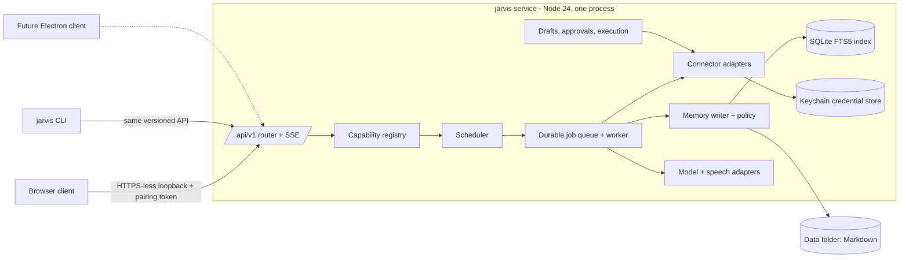

# Jarvis architecture

Jarvis is one local service with a thin browser client and a command line.
The service owns memory writes, credentials, tool authority, durable jobs, scheduling and action execution.
The browser client and the CLI render state and submit requests; neither writes memory or schedules work.



## Stack and why

| Concern | Choice | Reason |
| --- | --- | --- |
| Runtime | Node.js 24 LTS, bundled in the release artifact | Its built-in `node:sqlite` ships SQLite 3.53 with FTS5, so there is no native addon to rebuild per platform. Node 22.14 lacks FTS5 (verified). One language across service, web and plugin. |
| Service HTTP | `node:http` with a small router and server-sent events | Few moving parts; SSE gives ordered, resumable events with `Last-Event-ID`. |
| Contracts | `zod` schemas in `packages/contracts` | Shared by service, web and plugin; validated at the server boundary. |
| State | One SQLite database in the service state directory | Jobs, events, approvals, attention decisions, conversations, connection state. WAL mode. |
| Knowledge | Markdown files in the user's chosen data folder | Human-readable, Obsidian-compatible; the FTS index is rebuildable from the files. |
| Web client | React + Vite, `markdown-it` with raw HTML disabled | Small, well-known; imported Markdown cannot inject HTML or `javascript:` links. |
| Secrets | macOS Keychain via `/usr/bin/security -i` (values on stdin, never argv); 0600 file fallback off macOS | Outside the vault and outside frontend storage. |
| Remote sources | GitHub REST; Jira and Confluence through the Atlassian Rovo MCP server; Slack, Gmail and Calendar through the user's claude.ai connectors | Atlassian's MCP server and the organization's claude.ai connectors are the supported, admin-governed access paths, so no per-user Slack app or Google Cloud OAuth client is needed. The MCP client is about 200 lines because Jarvis needs only initialize, tools/call and its own OAuth flow on the existing loopback callback; the Claude Code control protocol is driven directly so the argument-level approval gate stays in Jarvis's code. |
| Install | Self-extracting installer bundling Node, the service bundle, web assets, launchd agent | One command/double-click; no developer tools required. |

## Data layout

Data folder (user-chosen, Markdown):

```
<data folder>/
  README.md                 what each area is for
  memory/                   curated memory (recalled as knowledge)
    people/ projects/ decisions/ notes/
    self.md                 identity record (protected)
  evidence/                 archived evidence, never presented as curated fact
    captures/ conversations/
    connectors/<kind>/       connector snapshots, one file per day per Machine
    sessions/                coding-agent session logs, one file per day per Machine (searchable)
      transcripts/<agent>/   redacted session transcripts (archived, never quoted by recall)
  deliverables/             generated work products (briefings, research, drafts)
```

Imported folders stay where they are.
The import preview lists what will be read, what is skipped and that zero files in the source folder change.
Imported files are indexed read-only as area `import` and cited by their real path and line range.

Service state (`~/Library/Application Support/Jarvis/state`): `jarvis.sqlite`, logs, runtime metadata, backups, downloaded speech models.
Writer locks (`~/Library/Application Support/Jarvis/locks`, `~/.local/state/jarvis/locks` on Linux, `JARVIS_LOCK_DIR` in tests): one file per data folder in use, named by a hash of the folder's real path.
Credentials: Keychain service `dev.jarvis.<instance>`.

### Machine identity and per-Machine evidence

Each Machine has an id (a UUID made once) and a name (the hostname without its domain until the owner renames it), kept in the `machine` table of the service database, never in the Brain.
`GET /machine` returns both; `PATCH /machine` renames (1 to 64 characters, no control characters); Settings shows them.
Evidence that every Machine appends to is written per Machine, so that Replication never merges two Machines' writes into one file (ADR 0001): session logs go to `evidence/sessions/<date>-<machine>.md` and connector snapshots to `evidence/connectors/<kind>/<date>-<machine>.md`.
`<machine>` is the name's slug plus the first eight hex digits of the id, so two Machines with the same name still write apart; the frontmatter records `machine` and `machine_id`.
Files written before this change keep their `<date>.md` name; search and the audit index them like any evidence, and the session context reads every file of a day, old or per-Machine, as that day's log.

## Memory model

Every memory note has frontmatter (`id`, `type`, `title`, `provenance`, `sources`, `created`, `updated`), a `## Current State` section with one dated entry per subject, optional `## Notes`, and an append-only `## History`.
A correction replaces the Current State entry and appends the superseded value, its date, source and the reason to History.
This is the state-versus-event rule from the old vault's 2026-08-13 repair, enforced by the writer rather than by instructions.

Write policy (deterministic, in `memory/policy.ts`):
- Only the service writes. Clients submit captures and corrections through the API.
- `memory/self.md` (identity) and authorization records (connection write permissions, stored in the database) change only through explicit user-authenticated settings endpoints; model output, imports and connector data can never write them.
- Model output never writes memory directly. Suggested memory changes are stored as proposals that the user applies or rejects.
- Writes are atomic (temp file + rename) under a per-path in-process lock; one service process owns the folder.
  A writer lock with the owner's pid and instance, kept in the per-user locks folder outside the data folder, refuses a second service of another instance while the owner is alive; a lock left by a process that is gone is taken over.
  A `.jarvis/writer.lock` left inside the data folder by an earlier version is honoured the same way and then removed.
- Paths are resolved and confined to the data folder; symlinks out of it are refused.

## Retrieval

Chunks are pieces of Markdown sections with exact line ranges (`memory/chunker.ts`).
Every entry under `## Current State` is its own chunk, cited at its own line, so a question retrieves the one fact that answers it however long the note is.
A fact's source stays in the cited text but is left out of the search index, so a query never matches a fact because of the file it was imported from; the fact's subject is indexed with the heading.
Other sections are cut into pieces of about 1,200 characters after a blank line or before a top-level list item, and never grow past 2,400 characters, so long lists and transcripts without blank lines still give narrow citations.
A single line longer than that stays whole, because a citation is a range of whole lines.
Each chunk is labelled `state`, `history` or `body`; History chunks are down-weighted and presented to the model as superseded.
Queries are tokenised and every term is quoted before FTS5 `MATCH`, blocking operator injection.
Ranking uses BM25 with column weights (title 6, heading 3, text 1), fused by reciprocal rank with a prefix-match list (`k = 60`), then adjusted: curated memory above imports, imports above evidence, current state above history.
No document takes more than half of the results while other documents still have hits, so a long note that matches by title does not crowd out its evidence.
When the user asks about the note they have open, that note is passed as whole sections (current state first) rather than as search hits, each limited to 6,000 characters.
A change to how files are chunked ships with a migration that clears every file's stored fingerprint, so the next scan re-chunks the data folder and imported folders while the old chunks stay searchable.
The index is updated synchronously on every service write, fixing the new build's unscheduled indexer (four weeks stale when inspected).
Edits made to the data folder outside the service (Obsidian, an editor, a coding agent) are picked up by a recursive file watcher (`memory/watcher.ts`): events are debounced (300 ms, at most 2 s for a continuous burst), then each changed Markdown path is re-indexed or removed on its own.
Folder creates, moves and deletes, watcher failures and a catch-up just after the watcher starts trigger an incremental rescan, and a rescan also runs every five minutes for events the OS dropped.
The watcher applies the same rules as the full scan: hidden and tool folders, non-Markdown files, files over 2 MB and symbolic links (the file or any parent folder) are never indexed.
If the data folder itself goes missing, the rescan is skipped so an unmounted drive does not empty the index.
Imported vaults are not watched; they are rescanned when their connection syncs.
Vector search is deliberately not in this release: no embedding model is guaranteed on a clean install, and lexical recall with exact citations is verifiable.

Answers: the service retrieves first, numbers the evidence `[S1]..[Sn]`, sends it to the model as quoted data with an instruction that documents are untrusted, and maps cited markers back to exact file and line ranges.
When nothing relevant is retrieved the answer is marked unsupported and the model is told to say so.
Without a model, chat returns the retrieved evidence directly and says no model is connected.

## Connections and transports

Every connection is an adapter with setup, test, sync, disconnect and coverage accounting (`apps/service/src/connectors/`).
Remote sources use one of three transports.

- **GitHub** uses its REST API with a token or the GitHub CLI login.
- **Jira and Confluence** use the Atlassian Rovo MCP server in one of two ways behind one interface (`atlassian-backend.ts`), so sync, attention, coverage and recovery rules are shared.
  By default they go through the user's claude.ai Atlassian Rovo connector (Rovo MCP v1 tools) on the same gated Claude Code path as Slack, Gmail and Calendar, described below.
  It is the default because some Atlassian organizations refuse other OAuth clients and API tokens while allowing claude.ai.
  The v1 views differ: Jira pages with `pageInfo.endCursor` passed back as `nextPageToken`; Confluence search returns no total and no next page, so a full page is reported `partial`; Confluence dates come back relative ("about 2 hours ago") and are kept out of timestamps and fingerprints.
  Alternatively, where the organization allows other clients, Jarvis connects directly to `https://mcp.atlassian.com/v2/mcp` through a small Streamable HTTP MCP client (`mcp-http.ts`, `atlassian.ts`).
  Jarvis calls the MCP tools directly, with no model in the loop: `searchJiraIssuesUsingJql`, `addOrEditJiraIssueComment`, `searchConfluence`, and `listJiraIssueComments`, `listConfluenceComments` and `createConfluenceComment` through `executeRead`/`executeWrite`.
  Sign-in is OAuth 2.1: protected-resource metadata (RFC 9728), then authorization-server metadata (RFC 8414), dynamic client registration for the loopback redirect (RFC 7591), PKCE S256 and a resource indicator (RFC 8707), with refresh tokens stored in the Keychain.
  An Atlassian API token created for the MCP server (app `mcp-v2`) is the alternative when the organization allows API tokens; a classic unscoped token is rejected with an explanation.
  The configured site is resolved to its cloud id on test, so a credential for the wrong site reports `denied` instead of reading nothing.
- **Slack, Gmail and Google Calendar** use the claude.ai connectors the user already has in their claude.ai workspace (for an organization account, the organization's connectors).
  Those connectors are only reachable through a claude.ai-authenticated Claude Code session, so `claude/session.ts` runs the user's own `claude` CLI headless with no built-in tools, hooks off, CLAUDE.md files off and a small model (`claude-haiku-4-5`).
  The model only relays calls.
  Every permission check is routed to Jarvis over the stream-json control protocol (`--permission-prompt-tool stdio`); Jarvis allows a call only when the tool and its arguments equal a planned call, once, and only for a server whose source is `claudeai`.
  Anything else is denied before it runs; in a write session any deviation fails the action.
  Results are read from the raw `tool_result` blocks in the event stream, never from the model's summary, and parsed by strict readers (`slack-format.ts`, `parseThreadPage`, `parseEventPage`) that count unreadable rows as partial coverage.
  A session refuses to start if the user's or the organization's managed Claude Code settings auto-approve that connector's tools, because such a rule would bypass the argument check.
  If a tool result still arrives for a call Jarvis was never asked about (a managed hook, for example), the session is stopped, its results are discarded and the connection reports `denied`.
  A long result that Claude Code spills to a file (a 50-issue Jira page is about 80 KB) is read back only from Claude Code's exact `<persisted-output>` wrapper, only from a file inside the project directory of Jarvis's own connector session, and the file is deleted once read, so a path planted in a message is never followed and connector data does not accumulate under `~/.claude`.
  A read session that stalls is started once more; a write session never is.
  The session waits for MCP connections (`MCP_CONNECTION_NONBLOCKING=false`); one that still meets a `pending` connector stops at init, before any call, and is started again.
  Independent pages (for example the first page of DMs and of mentions) share one session, so a Slack sync is a few sessions rather than one per call.

Authorization for the claude.ai connectors lives in claude.ai, so Jarvis stores no credential for them; disconnecting stops Jarvis's requests and deletes its retained data on request, while the connector itself stays connected in claude.ai.
Write actions keep the approval rules below.
The claude.ai connector tools and the Jira MCP comment tool cannot attach hidden metadata, so recovery after an interrupted write recognises an earlier attempt by content: it must be the user's own (the account id is required, never guessed), created after the pending attempt started (the outbox records that time and passes it as `since`, with two minutes of clock-skew allowance), with the same text once formatting is ignored (Markdown, ADF, Slack mrkdwn and storage HTML render links and emphasis differently).
Gmail drafts must also be in the same thread; Confluence comments still carry a hidden effect marker in storage format.
If that lookup itself fails, the outbox raises `EffectCheckError`: the action becomes `unknown` and the effect stays pending, so a failed check is never mistaken for "not sent".
Atlassian token refreshes are single-flight per connection because Atlassian rotates refresh tokens; a refresh rejected by Atlassian means "sign in again", while a network failure stays `offline`.
A sign-in that is started but not finished never replaces the stored OAuth client: a newly registered client is saved only when the callback succeeds.
Connections created before these transports lose their old credentials once at startup and show `needs auth` with an explanation, keeping their scopes, channels, site and write authority.
A `needs auth` connection without browser sign-in shows a Reconnect action on its card: for methods with secret fields it reopens the credential form, otherwise it re-runs the connection test; each auth method can carry `reconnectHelp`, the text telling the user what to fix outside Jarvis first.
A test that succeeds on a connection that was `needs auth` or `error` queues a sync of that connection, so its coverage no longer shows the failed run.
Before its first connector session the runner lists Claude Code's MCP servers with a session that disallows every MCP tool and stops at init, then hides every other server, because with tool search off their tool definitions would otherwise be inlined and can overflow the model's context; a session that still overflows lists again and is retried once.

## Attention and briefings

The attention engine follows these rules:
- Item identity (`key`) is separate from change detection (`fingerprint`). Fingerprints are SHA-256 over length-prefixed parts, truncated to 16 hex characters, so a separator cannot forge a collision.
- Keys use the work item identity (for example `jira:ISSUE-1`), and the category (due, overdue) goes in the fingerprint, fixing the due→overdue key churn.
- Transport-dependent fields (`updated_at`) are not fingerprint parts.
- An item is resolved only if its source was fully covered in this and the previous run.
- A dismissal records the fingerprint it applied to. Unchanged items stay dismissed; a changed fingerprint reopens the item with the reason.
- Snooze stores an absolute time and reopens only after it passes.
- Coverage per source per run is one of `complete`, `partial` (pagination stopped, rate limit, page cap), `denied` (scope/403), `unauthorized` (401/expired), `offline` (network), `error`, `not_configured`. A zero from a partial source is never shown as "nothing to do".
- Gmail read state is derived from `labelIds`, never inferred. A thread whose last message is from the user is never awaiting reply. All-day events are detected from their midnight-to-midnight shape. Calendar notification mails are excluded from pending replies.

## Jobs, scheduler and recovery

- A job row is committed before the API acknowledges it. Every progress step writes an ordered `job_events` row; clients reconnect with `Last-Event-ID` and receive every missed event plus retained results.
- The worker leases a job with an expiry. On service start, jobs with an expired lease are recovered from their last checkpoint.
- External side effects go through an outbox keyed by an idempotency key. The key is recorded as `pending` before the call and `done` with the verified result after it. A recovered job that finds `done` reuses the result; one that finds `pending` verifies with the remote before retrying, so a restart cannot double-post.
- Cancellation sets `cancel_requested_at`. The response and the job record state whether the work stopped (`stopped`) or the request arrived after completion (`too_late`).
- The scheduler lives in the service. Schedules are rows with `next_run_at`. A tick every 15 s runs due schedules; if the gap between ticks exceeds twice the interval (the Mac slept), missed runs are coalesced into one catch-up run instead of replaying every missed interval. Offline sources simply record `offline` coverage and are retried next tick.
- Browser tabs and service workers never schedule work.

## Drafts, approvals and execution

- A draft is an action record: kind, connection, target, payload, `payload_hash` (SHA-256 of canonical JSON), `version`, context/evidence, `expires_at`.
- Editing a draft increments `version` and changes the hash, invalidating any approval.
- Approval creates `{actionId, version, payloadHash, nonce, expiresAt, approvedBy}`.
- Execution requires the approval; the server rechecks, immediately before calling the adapter: action status, version, hash, nonce unused (atomically consumed), approval and action expiry, feature enabled, connection connected and the write action authorized for that connection.
- Status becomes `succeeded` only when the adapter returns a verified remote id (followed by a read-back where the API allows). Otherwise `failed` with the error, or `unknown` if the call timed out after sending.
- Receipts and every attempt are stored in `action_events`.
- Revoking an approval, disabling write authority or disconnecting prevents later execution.
- Expiry uses 48 business hours (weekends skipped); refreshing a draft keeps its original `created`.

## Security

- The service binds `127.0.0.1` only. The `Host` header must be the loopback address with the service port (prevents DNS rebinding).
- Clients pair: the installer or Settings issues a short-lived single-use pairing code; exchanging it yields a random token (stored hashed). The browser gets an `HttpOnly; SameSite=Strict` cookie; the CLI keeps its token in a 0600 file in the service state directory.
- `Origin`, when present, must be the service origin. State-changing requests also require `X-Jarvis-Client: 1`, which cross-site forms cannot send.
- Logs, evidence and API responses pass through redaction of known secret values and token patterns.
- Imported and connector content is data: it is rendered with raw HTML disabled, and it is quoted inside the model prompt with an instruction not to follow embedded instructions. The conversation model has no tools, so injected text cannot trigger actions.
- The connector sessions that reach claude.ai connectors do see external content in tool results, which is why each call is approved by argument equality before it runs and a write session fails on any deviation (see Connections and transports).

## Coding-agent sessions

Claude Code, Codex and Antigravity are connections (`connectors/agent.ts`, `agents/integrations.ts`).
Connecting one adds hooks to that agent's settings file, through an editor that only adds, replaces or removes entries whose command names `jarvis-agent-hook` and this install's `--state-dir`, so other tools' hooks and other Jarvis instances are never touched (`agents/hooks-config.ts`, `agents/install.ts`).
The file is backed up before every write, and a file Jarvis cannot parse is refused rather than overwritten.
Hook commands go through the installer's `current` symlink, so upgrades do not break them.

The hook (`agents/jarvis-agent-hook.ts`, bundled as `jarvis-agent-hook.mjs`) does no network calls and never waits for the service: SessionEnd budgets are 1.5 s (Claude Code) and 3 s (Codex).
On session end, compaction, or (Antigravity) a fully idle turn, it clones the transcript into `state/agents/spool/` and writes a small record last.
The service ingests the spool on change, every minute and at start, so a session ends up in the data folder even if Jarvis was stopped when it ended.
Ingest parses each agent's transcript format down to user and assistant text, dropping tool calls, tool output, thinking, injected reminders and developer-role context (where Jarvis's own memory block lands in Codex), archives it, and queues a `session-distill` job.
That job asks the model for durable decisions and lessons, appends one entry per session (or per continuation) to the day's session log, and records how many turns are summarised so a compaction followed by the end adds only new turns.
Antigravity reports every turn, so its summary waits until the conversation has been quiet for 15 minutes.

At session start the hook prints `state/agents/session-context.md`, which the service rewrites when memory changes: identity, an index of memory titles, the last two session logs, and the `jarvis search` command for deeper recall from the agent's shell.
Antigravity has no session-start hook, so the same text is written to an always-on rule file in `~/.gemini/config/rules/`.
Hooks skip sessions started with `CLAUDE_INVOKED_BY` set, and Jarvis's own model calls run with `--setting-sources ""`, so neither recurses.
Turning the feature off disconnects every agent; `jarvis-uninstall` runs `jarvis agent-hooks uninstall` first.

### Save and audit skills

Connecting an agent also installs two user-level skills, `jarvis-save` and `jarvis-audit` (`agents/skills.ts`, text in `agents/skill-text.ts`), in `~/.claude/skills`, `~/.agents/skills` (Codex) or `~/.gemini/config/skills` (Antigravity).
Only the user can invoke them: every skill folder carries `disable-model-invocation: true` (Claude Code, Antigravity) and `agents/openai.yaml` with `allow_implicit_invocation: false` (Codex, which ignores the frontmatter key), because an agent Jarvis is not connected to may read a shared folder, for example when `~/.claude/skills` is a symlink to `~/.agents/skills`.
A `.jarvis-skill.json` marker records the state folder and the connected agents a folder serves; Jarvis never writes or removes a folder without its own marker, removes a shared folder only when the last agent reading it disconnects, and rewrites the skills on each context refresh so upgrades reach them.
Skills call this install's CLI through the `current` path with `JARVIS_STATE_DIR` pinned, so they need nothing on `PATH`.

`jarvis save` and `jarvis audit` are clients of the running service (`cli/`), because the service holds the data folder's writer lock.
The CLI pairs itself on first use as client kind `cli` (the same trust as `jarvis pair`), keeps the token in `state/cli-token` (mode 0600), and pairs again if the token is revoked.
`POST /api/v1/memory/save` (`memory/save.ts`) validates every item before the first write: updates must name an existing note under `memory/` other than the identity record, a new note must not repeat an existing type and title, and no item may set one subject twice.
Facts go through the same correction path as the UI, so the old value moves to History; events are appended to History.
The write runs as the user, because saving is the user's explicit request; the note's provenance is `agent-saved`, and its source is the agent session (the archived transcript when Jarvis has one), detected from `CLAUDE_CODE_SESSION_ID`, `CODEX_THREAD_ID` or `ANTIGRAVITY_CONVERSATION_ID`.
`GET /api/v1/memory/audit` (`memory/audit.ts`) is read-only: every Current State entry with its age and source, the flags `stale`, `unsourced`, `missing-source` and `duplicate-subject`, newer passages about the fact, whether the note's first fact is in the session index, and notes whose titles reduce to the same name.
Newer passages are searched per fact (the note's title and the fact's subject), must name the note, and are dated by what they say rather than by file time: a current fact in another note by its own date, an evidence document by `observed_at`, `captured_at` or `date`, and only then by modification time.
The document a fact cites as its source, archives under `evidence/archive/`, generated deliverables, and history or undated prose in other notes are never offered, because none of them can overturn the fact.
It counts; the audit skill judges contradictions and proposes corrections through `jarvis save` for the user to approve.

## Capability registry

`capabilities/registry.ts` is the single definition of features (conversation, recall, capture, attention, drafts, jobs, voice, sessions) and connections, with their dependencies, required scopes, schedules and job kinds.
The setup checklist, dependency validation, API access checks (`requireFeature`) and scheduler all read it.
Disabling a feature disables its schedules, rejects its endpoints with `feature_disabled`, and cancels its queued jobs.
Disconnecting a connection deletes its credentials, stops new requests, cancels queued jobs that depend on it, revokes pending approvals targeting it, and offers to keep or delete its retained observations.

## Clients

- Browser: React. Home combines the attention inbox and a persistent conversation; Memory, People, Projects, Decisions, Drafts, Jobs, Connections and Settings are views linked to it.
- Obsidian: no plugin. The data folder is Obsidian-compatible Markdown, and edits made there are picked up by the file watcher. (A desktop plugin shipped until 0.2.x and was removed on 2026-10-30.)
- Electron: not in this release. The API is versioned (`/api/v1`) and has no browser-only assumptions, so an Electron shell can load the same web client.

## What was reused and what inspired the design

See `docs/inspection.md` for the evidence behind each item.
