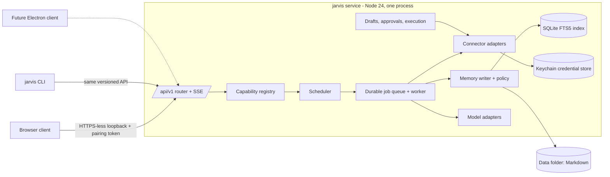

# Jarvis architecture

Jarvis is one local service with a thin browser client and a command line.
The service owns memory writes, credentials, tool authority, durable jobs, scheduling and action execution.
The browser client and the CLI render state and submit requests; neither writes memory or schedules work.



## Stack and why

| Concern | Choice | Reason |
| --- | --- | --- |
| Runtime | Node.js 24 LTS, bundled in the release artifact | Its built-in `node:sqlite` ships SQLite 3.53 with FTS5, so there is no native addon to rebuild per platform. Node 22.14 lacks FTS5 (verified). One language across service, web and plugin. |
| Service HTTP | `node:http` with a small router and server-sent events | Few moving parts; SSE gives ordered, resumable events with `Last-Event-ID`. |
| Contracts | `zod` schemas in `packages/contracts` | Shared by service, web and plugin; validated at the server boundary. |
| State | One SQLite database in the service state directory | Jobs, events, approvals, attention decisions, connection state. WAL mode. |
| Knowledge | Markdown files in the user's chosen data folder | Human-readable, Obsidian-compatible; the FTS index is rebuildable from the files. |
| Web client | React + Vite, `markdown-it` with raw HTML disabled | Small, well-known; imported Markdown cannot inject HTML or `javascript:` links. |
| Secrets | The operating system's secret store behind one interface: the macOS Keychain via `/usr/bin/security -i` (values on stdin, never argv); a 0600 file elsewhere for now | Outside the vault and outside frontend storage. |
| Remote sources | GitHub REST; Jira and Confluence through the Atlassian Rovo MCP server; Slack, Gmail and Calendar through the user's claude.ai connectors | Atlassian's MCP server and the organization's claude.ai connectors are the supported, admin-governed access paths, so no per-user Slack app or Google Cloud OAuth client is needed. The MCP client is about 200 lines because Jarvis needs only initialize, tools/call and its own OAuth flow on the existing loopback callback; the Claude Code control protocol is driven directly so the argument-level approval gate stays in Jarvis's code. |
| Install | Self-extracting installer bundling Node, the service bundle and web assets; the bundled `jarvis` sets up the background service and command-line wrappers | One command/double-click; no developer tools required. |

## Data layout

Data folder (user-chosen, Markdown):

```
<data folder>/
  README.md                 what each area is for
  memory/                   curated memory (recalled as knowledge)
    people/ projects/ decisions/ notes/
    self.md                 identity record (protected)
  evidence/                 archived evidence, never presented as curated fact
    captures/
    conversations/           chat archives from versions that had a chat (kept, never quoted by recall)
    connectors/<kind>/       connector snapshots, one file per day per Machine
    sessions/                coding-agent session logs, one file per day per Machine (searchable)
      transcripts/<agent>/   redacted session transcripts (archived, never quoted by recall)
    wrap-ups/                durable points of Harness conversations, from the wrap-up prompt (searchable)
  deliverables/             generated work products (briefings, research, drafts)
```

Imported folders stay where they are.
The import preview lists what will be read, what is skipped and that zero files in the source folder change.
Imported files are indexed read-only as area `import` and cited by their real path and line range.

Service state (`~/Library/Application Support/Jarvis/state` on macOS): `jarvis.sqlite`, logs, runtime metadata, backups.
Writer locks (`~/Library/Application Support/Jarvis/locks`, `~/.local/state/jarvis/locks` on Linux, `%LOCALAPPDATA%\Jarvis\locks` on Windows, `JARVIS_LOCK_DIR` in tests): one file per data folder in use, named by a hash of the folder's real path.
Credentials: Keychain service `dev.jarvis.<instance>` on macOS.

## Platform modules

Everything that differs between macOS, Linux and Windows lives in `apps/service/src/platform/`, so the rest of the service never calls an operating-system tool or hard-codes an operating-system path.

| Module | Interface | macOS | Linux | Windows |
| --- | --- | --- | --- | --- |
| `service-manager/` | `ServiceManager`: install, start, stop, uninstall, loaded | launchd agent `dev.jarvis.<instance>` | systemd user service (not yet) | logon task (not yet) |
| `secret-store/` | `SecretStore`: get, set, delete, keys | Keychain | owner-only file until Secret Service arrives | owner-only file until Credential Manager arrives |
| `notifier/` | `Notifier`: notify | Notification Center via `osascript` | none yet | none yet |
| `locations.ts` | install prefix, state folder, command folder, service definition folder, `tar`, managed Claude Code settings, tool folders | `~/Library/Application Support/Jarvis` | XDG base directories | `%LOCALAPPDATA%\Jarvis` |
| `harness-locations.ts` | each Harness's hooks file, rules folder, MCP configuration file, earlier skills folder, executables and install markers | | | |
| `wrapper.ts` | the release launcher and the `jarvis` and `jarvis-uninstall` wrappers | POSIX shell | POSIX shell | `.cmd` |

`os.ts` maps Node's platform to one of the three; any other operating system gets one clear message from every command instead of a failure halfway through.
The installer and uninstaller are thin shell scripts that call the bundled `jarvis` (`jarvis service`, `jarvis wrappers`, `jarvis credentials clear`, `jarvis paths`), so their platform-specific work is the same code the service uses.
`jarvis paths` prints every resolved location for the computer it runs on.

### Machine identity and per-Machine evidence

Each Machine has an id (a UUID made once) and a name (the hostname without its domain until the owner renames it), kept in the `machine` table of the service database, never in the Brain.
`GET /machine` returns both; `PATCH /machine` renames (1 to 64 characters, no control characters); Settings shows them.
Evidence that every Machine appends to is written per Machine, so that Replication never merges two Machines' writes into one file (ADR 0001): session logs go to `evidence/sessions/<date>-<machine>.md` and connector snapshots to `evidence/connectors/<kind>/<date>-<machine>.md`.
`<machine>` is the name's slug plus the first eight hex digits of the id, so two Machines with the same name still write apart; the frontmatter records `machine` and `machine_id`.
Wrap-ups are new files rather than appends, and carry the tag too (`evidence/wrap-ups/<date>-<machine>-<title>.md`), so two Machines never create the same file.
Files written before this change keep their `<date>.md` name; search and the audit index them like any evidence, and the session context reads every file of a day, old or per-Machine, as that day's log.

## Replication

Replication keeps every Machine's copy of the Brain the same through a git repository (ADR 0001); the whole Brain replicates (ADR 0002).
The code is in `apps/service/src/replication/`; `App.replication` owns it, and `POST /replication/setup`, `POST /replication/join`, `GET /replication` and `POST /replication/check` expose it (`jarvis replication` calls them).

- **Local state.** The `replication` table holds the data folder, the remote, the last change-log `seq` already described in a commit, and the last status.
  No row means off.
  A data folder other than the one Replication was set up for reads as blocked.
- **The repository.** Setup runs `git init -b main` in the data folder, marks it with `jarvis.managed=true` (a repository Jarvis did not make is refused), writes `.gitignore` (`.jarvis/`, `.*.tmp`, `.DS_Store`, `Thumbs.db`, `.obsidian/workspace*.json`) and `.gitattributes` (`* text=auto eol=lf`), commits and pushes.
  It refuses a remote whose `main` already has commits.
  Join clones `main` into an empty folder, then opens it like `/setup/data-folder`, which indexes it.
- **The loop** (`replication.ts`): triggered 30 seconds after the last write (`MemoryStore` `onWrite`), on an outside edit the file watcher sees, at start, on wake (`Scheduler.onResume`) and by a one-minute check.
  One check at a time: commit everything (`git add -A`, so hand edits are included), fetch, commit what was saved meanwhile, merge, push; when the push is rejected because another Machine pushed first, fetch, merge and push again, up to five times, then retry with backoff.
  Failures set the status (offline, unauthorized, blocked) and never reach a save.
- **Writes pause while git changes the folder.** Commit and merge run synchronously (`BrainRepo`, `Git.runSync`), so no save can land halfway through them; only fetch, push and clone wait on the network asynchronously.
  A merge left behind by a crash (`MERGE_HEAD`) is aborted at the next check and merged again.
- **Never rewrites history.** Bringing in other Machines' changes is a fast-forward or a merge commit; `Git` refuses `rebase`, `pull`, `reset --hard` and any forced or deleting push before running git.
- **Merging.** A file both sides changed goes to the merge rules (`MergeRule` in `seams.ts`); a file no rule settles aborts the merge and reads as blocked with its path, so no conflict marker is ever left in a file.
  Files the merge changed are re-indexed straight away (`Replication.onPulled`), before the file watcher would notice them.
- **Commits** are authored by the Machine (name, and `<machine id>@machine.jarvis.invalid`), with the clock's time.
  The message names each changed file and what the change log says happened to it (`created "Orion migration"`, `corrected Status`, `added an event`), or `added`/`edited`/`deleted` for files the change log does not know (hand edits, evidence), and ends with a `Jarvis-Machine: <name> (<id>)` trailer.
- **Seams** (`replication/seams.ts`, listed in `defaultSeams()`): `mergeRules`, `commitGuards` (run on the staged files before every commit, merge commits included; a refusal stops the commit and the push), `remoteGuards` (run at setup, join and before every push), and `credentials` (`-c` settings and environment for commands that reach the remote, so a token never sits in the remote's address).
  `Replication.onPulled` and `onMergeNotice` let other parts of the service react to merged files and to what the rules want the owner to see.
- **Time** comes from a `Clock` (`replication/clock.ts`): the system clock in the service, a hand-moved clock in tests.
- **Git** is the Machine's own: `JARVIS_GIT_BIN`, else the first `git` in the platform's usual tool folders (`platform/locations.ts` `toolCandidates`), else the PATH.
  It runs with hooks, signing and the `ext` transport switched off, `LC_ALL=C` and no terminal prompts, whatever the owner's own git config says.

## Memory model

Every memory note has frontmatter (`id`, `type`, `title`, `provenance`, `sources`, `created`, `updated`), a `## Current State` section with one dated entry per subject, optional `## Notes`, and an append-only `## History`.
A correction replaces the Current State entry and appends the superseded value, its date, source and the reason to History.

An entry may carry a Review date after its own date: `- **Status** (2026-11-10, review 2026-11-13): value — source: …`.
The parser (`memory/markdown.ts`) also reads hand edits that vary the spacing, write `Review` or add a colon after it; the writer always writes the form above.
A save or Proposal sets it per fact (`review`, `YYYY-MM-DD`, checked in `memory/save-items.ts` to be after today, the new entry's date).
A correction writes only the Review date it is given, so a date set for the old value never follows the new one; the superseded History line keeps the old Review date.
Days are UTC calendar days, the same days facts are dated with (`memory/review-date.ts`).
Past its Review date a fact stays in the Brain and is shown as unverified: search hits (`review`, `unverified`), the document view's `state` entries, MCP `search` and `read`, the terminal search, the session context files and the Dashboard all mark it, computed when they are read.
This is the state-versus-event rule from the old vault's 2026-08-13 repair, enforced by the writer rather than by instructions.

Write policy (deterministic, in `memory/policy.ts`):
- Only the service writes.
  A Harness submits saves through the MCP server or `jarvis save`; the Dashboard only decides on Proposals and reverts recent saves (ADR 0003), so the service has no capture, note creation, correction or note-body endpoint.
- `memory/self.md` (identity) and authorization records (connection write permissions, stored in the database) change only through explicit user-authenticated settings endpoints; model output, imports and connector data can never write them.
- Model output never writes memory directly. Suggested memory changes are stored as Proposals that the user applies or rejects.
  A Proposal holds one whole save item (see below), so one click applies a new note with several facts, or several facts and events on one note.
- Writes are atomic (temp file + rename) under a per-path in-process lock; one service process owns the folder.
  A writer lock with the owner's pid and instance, kept in the per-user locks folder outside the data folder, refuses a second service of another instance while the owner is alive; a lock left by a process that is gone is taken over.
  A `.jarvis/writer.lock` left inside the data folder by an earlier version is honoured the same way and then removed.
- Paths are resolved and confined to the data folder; symlinks out of it are refused.

## Retrieval

Chunks are pieces of Markdown sections with exact line ranges (`memory/chunker.ts`).
Every entry under `## Current State` is its own chunk, cited at its own line, so a question retrieves the one fact that answers it however long the note is.
A fact's source and Review date stay in the cited text but are left out of the search index, so a query never matches a fact because of the file it was imported from or the day it is due for review; the fact's subject is indexed with the heading.
Other sections are cut into pieces of about 1,200 characters after a blank line or before a top-level list item, and never grow past 2,400 characters, so long lists and transcripts without blank lines still give narrow citations.
A single line longer than that stays whole, because a citation is a range of whole lines.
Each chunk is labelled `state`, `history` or `body`; History chunks are down-weighted and presented to the model as superseded.
Queries are tokenised and every term is quoted before FTS5 `MATCH`, blocking operator injection.
Ranking uses BM25 with column weights (title 6, heading 3, text 1), fused by reciprocal rank with a prefix-match list (`k = 60`), then adjusted: curated memory above imports, imports above evidence, current state above history.
No document takes more than half of the results while other documents still have hits, so a long note that matches by title does not crowd out its evidence.
A change to how files are chunked ships with a migration that clears every file's stored fingerprint, so the next scan re-chunks the data folder and imported folders while the old chunks stay searchable.
The index is updated synchronously on every service write, fixing the new build's unscheduled indexer (four weeks stale when inspected).
Edits made to the data folder outside the service (Obsidian, an editor, a coding agent) are picked up by a recursive file watcher (`memory/watcher.ts`): events are debounced (300 ms, at most 2 s for a continuous burst), then each changed Markdown path is re-indexed or removed on its own.
Folder creates, moves and deletes, watcher failures and a catch-up just after the watcher starts trigger an incremental rescan, and a rescan also runs every five minutes for events the OS dropped.
The watcher applies the same rules as the full scan: hidden and tool folders, non-Markdown files, files over 2 MB and symbolic links (the file or any parent folder) are never indexed.
If the data folder itself goes missing, the rescan is skipped so an unmounted drive does not empty the index.
Imported vaults are not watched; they are rescanned on each Source refresh of their connection.

Meaning-based search (`meaning/`) runs a small multilingual sentence-embedding model on the Machine: multilingual-e5-small with 8-bit weights, 384 dimensions, pinned to one Hugging Face revision (`meaning/model.ts`).
It runs on ONNX Runtime's WebAssembly build (`onnxruntime-web`) with the pure-JavaScript Hugging Face tokenizer (`@huggingface/tokenizers`), so one set of files works on macOS, Linux and Windows with no native module to build or ship per platform; the release carries `ort-wasm-simd-threaded.wasm` and `.mjs` next to the service bundle.
The model is not in the release: the owner starts its download from the Dashboard (`POST /memory/meaning/download`), each file is checked against its size and SHA-256, and the folder `<state>/models/<model id>/` appears only once every file has passed.
After that it runs offline.
`JARVIS_MEANING_MODEL` names a JSON model description to use instead (a mirror, or the fixture model in tests).
Each chunk stores the text its vector is made from (title, heading and the same text keyword search matches) and that text's SHA-256.
Vectors live in `chunk_vectors`, keyed by model id and text hash, in the Machine's own SQLite index: they never enter the Brain and do not replicate, and re-chunking a file keeps the vectors of text that did not change.
A background builder (`meaning/builder.ts`) embeds chunks without a vector in batches of eight whenever the indexer reports a change, then drops vectors no chunk uses.
`GET /memory/meaning` and every search response carry the state (`missing`, `downloading`, `failed`, `building`, `ready`), the download progress and how many chunks have vectors; search answers on keywords in every state, and the MCP `search` tool starts with a line saying so until vectors are ready.
Meaning-based results do not yet join the ranking.

Search quality is measured by recall evaluation (`memory/recall-evaluation.ts`, `POST /memory/recall-evaluation`, `jarvis evaluate-recall`).
A question set names, per question, the note and the subject of the current fact expected to answer it.
Each question runs through the same search a Harness gets (8 results, raw archives excluded), and a result counts only when it is that fact's own chunk.
The report gives how often the expected fact is first and how often it is in the first three, every question not answered first with the first three results, and, unscored, every question whose note or fact is not in the Brain.
The owner's set lives in the Brain at `evaluation/recall-questions.json`, as JSON so the indexer never reads it; a synthetic Brain with its own set lives in `apps/service/test/fixtures/recall-brain/` and runs with the test suite.

Jarvis holds no conversation of its own (ADR 0003): a Harness asks the Brain through search and read.
Research findings and drafts still use the model: the service retrieves first, numbers the evidence `[S1]..[Sn]`, sends it to the model as quoted data with an instruction that documents are untrusted, and maps cited markers back to exact file and line ranges.
Without a model, research lists the retrieved evidence instead of written findings.
Installs from before ADR 0003 drop their stored conversations and messages on upgrade; the chat archives already written to `evidence/conversations/` stay in the Brain, out of recall.

## Connections and transports

Every connection is an adapter with setup, test, sync, disconnect and coverage accounting (`apps/service/src/connectors/`).
Remote sources use one of three transports.

- **GitHub** uses its REST API with a token or the GitHub CLI login.
- **Jira and Confluence** use the Atlassian Rovo MCP server in one of two ways behind one interface (`atlassian-backend.ts`), so sync, attention, coverage and recovery rules are shared.
  By default they go through the user's claude.ai Atlassian Rovo connector (Rovo MCP v1 tools) on the same gated Claude Code path as Slack, Gmail and Calendar, described below.
  It is the default because some Atlassian organizations refuse other OAuth clients and API tokens while allowing claude.ai.
  The v1 views differ: Jira pages with `pageInfo.endCursor` passed back as `nextPageToken`; Confluence search returns no total and no next page, so a full page is reported `partial`; Confluence dates come back relative ("about 2 hours ago") and are kept out of timestamps and fingerprints.
  Alternatively, where the organization allows other clients, Jarvis connects directly to `https://mcp.atlassian.com/v2/mcp` through a small Streamable HTTP MCP client (`mcp-http.ts`, `atlassian.ts`).
  Jarvis calls the MCP tools directly, with no model in the loop: `searchJiraIssuesUsingJql`, `addOrEditJiraIssueComment`, `searchConfluence`, and `listJiraIssueComments`, `listConfluenceComments` and `createConfluenceComment` through `executeRead`/`executeWrite`.
  Sign-in is OAuth 2.1: protected-resource metadata (RFC 9728), then authorization-server metadata (RFC 8414), dynamic client registration for the loopback redirect (RFC 7591), PKCE S256 and a resource indicator (RFC 8707), with refresh tokens stored in the Keychain.
  An Atlassian API token created for the MCP server (app `mcp-v2`) is the alternative when the organization allows API tokens; a classic unscoped token is rejected with an explanation.
  The configured site is resolved to its cloud id on test, so a credential for the wrong site reports `denied` instead of reading nothing.
- **Slack, Gmail and Google Calendar** use the claude.ai connectors the user already has in their claude.ai workspace (for an organization account, the organization's connectors).
  Those connectors are only reachable through a claude.ai-authenticated Claude Code session, so `claude/session.ts` runs the user's own `claude` CLI headless with no built-in tools, hooks off, CLAUDE.md files off and a small model (`claude-haiku-4-5`).
  The model only relays calls.
  Every permission check is routed to Jarvis over the stream-json control protocol (`--permission-prompt-tool stdio`); Jarvis allows a call only when the tool and its arguments equal a planned call, once, and only for a server whose source is `claudeai`.
  Anything else is denied before it runs; in a write session any deviation fails the action.
  Results are read from the raw `tool_result` blocks in the event stream, never from the model's summary, and parsed by strict readers (`slack-format.ts`, `parseThreadPage`, `parseEventPage`) that count unreadable rows as partial coverage.
  A session refuses to start if the user's or the organization's managed Claude Code settings auto-approve that connector's tools, because such a rule would bypass the argument check.
  If a tool result still arrives for a call Jarvis was never asked about (a managed hook, for example), the session is stopped, its results are discarded and the connection reports `denied`.
  A long result that Claude Code spills to a file (a 50-issue Jira page is about 80 KB) is read back only from Claude Code's exact `<persisted-output>` wrapper, only from a file inside the project directory of Jarvis's own connector session, and the file is deleted once read, so a path planted in a message is never followed and connector data does not accumulate under `~/.claude`.
  A read session that stalls is started once more; a write session never is.
  The session waits for MCP connections (`MCP_CONNECTION_NONBLOCKING=false`); one that still meets a `pending` connector stops at init, before any call, and is started again.
  Independent pages (for example the first page of DMs and of mentions) share one session, so a Slack sync is a few sessions rather than one per call.

Authorization for the claude.ai connectors lives in claude.ai, so Jarvis stores no credential for them; disconnecting stops Jarvis's requests and deletes its retained data on request, while the connector itself stays connected in claude.ai.
Write actions keep the approval rules below.
The claude.ai connector tools and the Jira MCP comment tool cannot attach hidden metadata, so recovery after an interrupted write recognises an earlier attempt by content: it must be the user's own (the account id is required, never guessed), created after the pending attempt started (the outbox records that time and passes it as `since`, with two minutes of clock-skew allowance), with the same text once formatting is ignored (Markdown, ADF, Slack mrkdwn and storage HTML render links and emphasis differently).
Gmail drafts must also be in the same thread; Confluence comments still carry a hidden effect marker in storage format.
If that lookup itself fails, the outbox raises `EffectCheckError`: the action becomes `unknown` and the effect stays pending, so a failed check is never mistaken for "not sent".
Atlassian token refreshes are single-flight per connection because Atlassian rotates refresh tokens; a refresh rejected by Atlassian means "sign in again", while a network failure stays `offline`.
A sign-in that is started but not finished never replaces the stored OAuth client: a newly registered client is saved only when the callback succeeds.
Connections created before these transports lose their old credentials once at startup and show `needs auth` with an explanation, keeping their scopes, channels, site and write authority.
A `needs auth` connection without browser sign-in shows a Reconnect action on its card: for methods with secret fields it reopens the credential form, otherwise it re-runs the connection test; each auth method can carry `reconnectHelp`, the text telling the user what to fix outside Jarvis first.
A test that succeeds on a connection that was `needs auth` or `error` queues a sync of that connection, so its coverage no longer shows the failed run.
Before its first connector session the runner lists Claude Code's MCP servers with a session that disallows every MCP tool and stops at init, then hides every other server, because with tool search off their tool definitions would otherwise be inlined and can overflow the model's context; a session that still overflows lists again and is retried once.

## Attention and briefings

The attention engine follows these rules:
- Item identity (`key`) is separate from change detection (`fingerprint`). Fingerprints are SHA-256 over length-prefixed parts, truncated to 16 hex characters, so a separator cannot forge a collision.
- Keys use the work item identity (for example `jira:ISSUE-1`), and the category (due, overdue) goes in the fingerprint, fixing the due→overdue key churn.
- Transport-dependent fields (`updated_at`) are not fingerprint parts.
- An item is resolved only if its source was fully covered in this and the previous run.
- A dismissal records the fingerprint it applied to. Unchanged items stay dismissed; a changed fingerprint reopens the item with the reason.
- Snooze stores an absolute time and reopens only after it passes.
- Coverage per source per run is one of `complete`, `partial` (pagination stopped, rate limit, page cap), `denied` (scope/403), `unauthorized` (401/expired), `offline` (network), `error`, `not_configured`. A zero from a partial source is never shown as "nothing to do".
- Gmail read state is derived from `labelIds`, never inferred. A thread whose last message is from the user is never awaiting reply. All-day events are detected from their midnight-to-midnight shape. Calendar notification mails are excluded from pending replies.

## Jobs, scheduler and recovery

- A job row is committed before the API acknowledges it. Every progress step writes an ordered `job_events` row; clients reconnect with `Last-Event-ID` and receive every missed event plus retained results.
- The worker leases a job with an expiry. On service start, jobs with an expired lease are recovered from their last checkpoint.
- External side effects go through an outbox keyed by an idempotency key. The key is recorded as `pending` before the call and `done` with the verified result after it. A recovered job that finds `done` reuses the result; one that finds `pending` verifies with the remote before retrying, so a restart cannot double-post.
- Cancellation sets `cancel_requested_at`. The response and the job record state whether the work stopped (`stopped`) or the request arrived after completion (`too_late`).
- The scheduler lives in the service. Schedules are rows with `next_run_at`. A tick every 15 s runs due schedules; if the gap between ticks exceeds twice the interval (the Mac slept), missed runs are coalesced into one catch-up run instead of replaying every missed interval. Offline sources simply record `offline` coverage and are retried next tick.
- Browser tabs and service workers never schedule work.

## Drafts, approvals and execution

- A draft is an action record: kind, connection, target, payload, `payload_hash` (SHA-256 of canonical JSON), `version`, context/evidence, `expires_at`.
- Editing a draft increments `version` and changes the hash, invalidating any approval.
- Approval creates `{actionId, version, payloadHash, nonce, expiresAt, approvedBy}`.
- Execution requires the approval; the server rechecks, immediately before calling the adapter: action status, version, hash, nonce unused (atomically consumed), approval and action expiry, feature enabled, connection connected and the write action authorized for that connection.
- Status becomes `succeeded` only when the adapter returns a verified remote id (followed by a read-back where the API allows). Otherwise `failed` with the error, or `unknown` if the call timed out after sending.
- Receipts and every attempt are stored in `action_events`.
- Revoking an approval, disabling write authority or disconnecting prevents later execution.
- Expiry uses 48 business hours (weekends skipped); refreshing a draft keeps its original `created`.

## Security

- The service binds `127.0.0.1` only. The `Host` header must be the loopback address with the service port (prevents DNS rebinding).
- Clients pair: the installer or Settings issues a short-lived single-use pairing code; exchanging it yields a random token (stored hashed). The browser gets an `HttpOnly; SameSite=Strict` cookie; the CLI keeps its token in a 0600 file in the service state directory.
- `Origin`, when present, must be the service origin. State-changing requests also require `X-Jarvis-Client: 1`, which cross-site forms cannot send.
- Logs, evidence and API responses pass through redaction of known secret values and token patterns.
- Imported and connector content is data: it is rendered with raw HTML disabled, and it is quoted inside the model prompt with an instruction not to follow embedded instructions. The model Jarvis calls has no tools, so injected text cannot trigger actions.
- The connector sessions that reach claude.ai connectors do see external content in tool results, which is why each call is approved by argument equality before it runs and a write session fails on any deviation (see Connections and transports).

## Harness sessions

Claude Code, Codex, Antigravity and Claude Desktop are connections (`connectors/agent.ts`, `agents/integrations.ts`).
Connecting one with hooks adds them to that Harness's settings file, through an editor that only adds, replaces or removes entries whose command names `jarvis-agent-hook` and this install's `--state-dir`, so other tools' hooks and other Jarvis instances are never touched (`agents/hooks-config.ts`, `agents/install.ts`).
The file is backed up before every write, and a file Jarvis cannot parse is refused rather than overwritten.
Hook commands go through the installer's `current` symlink, so upgrades do not break them.

The hook (`agents/jarvis-agent-hook.ts`, bundled as `jarvis-agent-hook.mjs`) does no network calls and never waits for the service: SessionEnd budgets are 1.5 s (Claude Code) and 3 s (Codex).
On session end, compaction, or (Antigravity) a fully idle turn, it clones the transcript into `state/agents/spool/` and writes a small record last.
The service ingests the spool on change, every minute and at start, so a session ends up in the data folder even if Jarvis was stopped when it ended.
Ingest parses each agent's transcript format down to user and assistant text, dropping tool calls, tool output, thinking, injected reminders and developer-role context (where Jarvis's own memory block lands in Codex), archives it, and queues a `session-distill` job.
That job asks the model for durable decisions and lessons, appends one entry per session (or per continuation) to the day's session log, and records how many turns are summarised so a compaction followed by the end adds only new turns.
Antigravity reports every turn, so its summary waits until the conversation has been quiet for 15 minutes.

At session start the hook prints a session context the service rewrites whenever the Brain changes (`agents/context-files.ts`).
The global context, `state/agents/session-context.md`, holds identity, an index of memory titles, the last two session logs, and the `jarvis search` command for deeper recall from the agent's shell.
A project note lists its repositories in its `Repositories` fact (`memory/repositories.ts`); every form of a repository, `owner/name` (GitHub), `host/owner/name`, an SSH or an HTTPS remote, reduces to one key, `host/owner/name` in lower case.
For each project that lists one, the service writes `state/agents/projects/<slug>.md`, the global context with that project's current state first, and then `state/agents/projects/repositories.json`, which maps each key to its file; a repository two projects list goes to the more recently updated one.
The hook reads the remotes of the session's folder from the repository's own git config, following a worktree's `gitdir` and `commondir` (`agents/git-remotes.ts`), runs no `git` process, and prints the first matching project's file, or the global one.
A save or a Proposal that sets a project's `Repositories` fact to anything that is not a list of repositories is refused (`memory/save-items.ts`, the validation both share).
Antigravity has no session-start hook, so the same text is written to an always-on rule file in `~/.gemini/config/rules/`.
Hooks skip sessions started with `CLAUDE_INVOKED_BY` set, and Jarvis's own model calls run with `--setting-sources ""`, so neither recurses.
Turning the feature off disconnects every Harness with hooks; `jarvis-uninstall` runs `jarvis agent-hooks uninstall` first, which also removes the MCP server.

### MCP server in each Harness

Connecting a Harness also registers Jarvis's MCP server in that Harness's MCP configuration (`agents/mcp-registration.ts`), in one step with the hooks: `~/.claude.json` (Claude Code's user-level servers), `~/.codex/config.toml`, `~/.gemini/config/mcp_config.json`, and Claude Desktop's `claude_desktop_config.json`, whose folder differs per operating system (`platform/harness-locations.ts`).
Claude Desktop is a Harness with the MCP server only; its Code tab runs Claude Code, whose hooks already save those sessions.
The entry is named `jarvis` for the default install (`jarvis-<hash>` for another instance) and runs `jarvis mcp --state-dir <state>` through the bundled runtime and the `current` path; an entry is Jarvis's when its arguments run `mcp` for this state folder, whatever its name.
JSON files are edited as JSON (`agents/mcp-config-json.ts`); Codex's TOML is edited as text, taking out Jarvis's `[mcp_servers.<name>]` tables and appending a fresh one, and a TOML parser checks before and after that nothing but Jarvis's entry changed, so comments and layout survive and any other outcome is refused (`agents/mcp-config-toml.ts`).
An entry under Jarvis's name that Jarvis did not add is refused, as is a file that does not parse.
Every change across the hooks file, the MCP file and the rule file is worked out before the first write, so a refused file leaves the Harness untouched.
Disconnecting removes the hooks, the rule and the server, trying each even when another fails, and reports the failures together.

When the service starts, it re-registers the server for connected Harnesses whose entry no longer matches this version, and removes the save and audit skill folders earlier versions installed: only folders whose `.jarvis-skill.json` marker names this install's state folder, in `~/.claude/skills`, `~/.agents/skills` and `~/.gemini/config/skills` (`agents/legacy-skills.ts`).
The MCP prompts replace those skills, and there is no `jarvis save` command any more, because a save must be confirmed by the owner inside a Harness, which a shell cannot do.

`jarvis audit` and the MCP server are clients of the running service (`cli/`, `mcp/`), because the service holds the data folder's writer lock.
Each pairs itself on first use as client kind `cli` (the same trust as `jarvis pair`), keeps the token in `state/cli-token` (mode 0600), and pairs again if the token is revoked.
`POST /api/v1/memory/save` (`memory/save.ts`) validates every item before the first write: updates must name an existing note under `memory/` other than the identity record, a new note must not repeat an existing type and title, and no item may set one subject twice.
Facts go through the store's correction path, so the old value moves to History; events are appended to History.
Each item is written to its note in a single file write (`memory/save-items.ts`), so an item lands whole or not at all.

A Proposal (`memory/proposals.ts`) holds exactly one such item, with the reason it was suggested and the evidence it cites.
`POST /api/v1/memory/proposals` runs the save's validation before recording it, `GET /api/v1/memory/proposals?status=proposed` lists pending ones with the whole item, and `POST /api/v1/memory/proposals/:id/apply|reject` decides one.
Applying validates the item again, because the Brain may have changed since, then writes it as the service with the approved-Proposal permission and provenance `user-approved`; a refusal leaves the Proposal pending and the Brain untouched.
Rejecting writes nothing.
Proposals are rows in `memory_changes` with `change = 'proposal'`; rows made before Proposals carried save items (one fact in `{ value, newDoc }`) are read as the equivalent one-fact item, so they still apply and reject.
The write runs as the user, because saving is the user's explicit request; the note's provenance is `agent-saved`, and its source is the agent session (the archived transcript when Jarvis has one), detected from `CLAUDE_CODE_SESSION_ID`, `CODEX_THREAD_ID` or `ANTIGRAVITY_CONVERSATION_ID` in the environment the Harness gives the MCP server (`mcp/agent-env.ts`).
`GET /api/v1/memory/audit` (`memory/audit.ts`) is read-only: every Current State entry with its age, Review date and source, the flags `stale`, `unsourced`, `missing-source` and `duplicate-subject`, newer passages about the fact, whether the note's first fact is in the session index, and notes whose titles reduce to the same name.
Newer passages are searched per fact (the note's title and the fact's subject), must name the note, and are dated by what they say rather than by file time: a current fact in another note by its own date, an evidence document by `observed_at`, `captured_at` or `date`, and only then by modification time.
The document a fact cites as its source, archives under `evidence/archive/`, generated deliverables, and history or undated prose in other notes are never offered, because none of them can overturn the fact.
It counts; the audit prompt has the agent judge contradictions and propose corrections through the MCP `save` tool, which the owner confirms.

### Recent saves and revert

Every write to the Brain is recorded in the change log (`memory_changes`) with the Harness and session it came from, a batch id shared by all changes one save or one applied Proposal made, and a SHA-256 of the note right after the write.
`GET /api/v1/memory/recent-changes` (`memory/recent-changes.ts`) lists applied changes newest first, leaving out Proposal rows (an applied Proposal shows as the change it made), each with whether it can be reverted and, if not, why.
`POST /api/v1/memory/changes/:id/revert` (`memory/revert.ts`) undoes one change as the user and records the undo as a change of its own whose `reverts` names the original.
A corrected fact is corrected back to its previous value and the Review date that value had (the change log keeps both, `before_review` and `after_review`), a fact that had no previous value is moved from Current State into History, a created note is deleted from the data folder and the index, and a deleted note is restored from the copy its delete change keeps.
A change is revertible only while it is the last word: no later change touched the same fact (a later change and its own revert cancel out, so undo works like a stack), no later save touched a created note, and the file still matches what the change wrote (the fact's value and Review date, or the note's hash for a created note), so a hand edit or a change from elsewhere is never thrown away.
Events are append-only History and are never reverted.

## MCP server

`jarvis mcp` (`mcp/`) is an MCP server a Harness starts as a local process over stdio, built on `@modelcontextprotocol/sdk`.
It is a client of the running service like `jarvis audit`: it pairs as client kind `cli` and keeps the token in `state/cli-token`, so a Harness's configuration holds only the command.
Every tool call builds a fresh client from `state/runtime.json`, so a server started before the service works once the service runs, and a stopped service is reported on the call that meets it with how to start it.
The server starts even when the service is down, because a Harness launches its MCP servers when it starts and would otherwise mark Jarvis as failed.

- `search` calls `GET /api/v1/memory/search?recall=1`, which applies the recall exclusions (`RECALL_EXCLUDE`: old chat archives and raw session transcripts); without `recall=1` the Dashboard still searches everything.
  Each passage carries its path (relative to the Brain, or absolute for another indexed folder), line range, area, section kind and note title.
  The area tells curated memory, the only place a current fact can come from, apart from evidence, deliverables and imported notes.
- `read` calls `GET /api/v1/memory/document`, which also accepts an absolute path inside the Brain or another indexed folder when no `root` is given, and slices the requested 1-based, inclusive line range from the raw file, so lines match search citations.
- `audit` calls `GET /api/v1/memory/audit` and returns the report with every file named by one path, the same kind `search` returns (`memory/audit-view.ts`, shared with `jarvis audit`, which shows absolute paths instead).
  It is read-only and marked so (`readOnlyHint`).
- The `save` and `audit` prompts (`mcp/prompt-text.ts`) carry the procedures of the save and audit skills earlier versions installed, with the MCP tools in place of shell commands.
  Each takes one optional argument (`focus`, `topic`) appended to the text, and returns one user message.
- `save` takes `items` with the `MemorySaveItem` schema of `POST /memory/save`.
  It checks them with `POST /memory/save/check` (the save's own validation, no write), so an invalid item or the identity record is refused before the owner is asked.
  The check also answers `autoAccept`: whether the owner switched on auto-accept for the origin's Harness on this Machine.
  If so, the tool writes through `POST /memory/save` with `autoAccept: true` and no confirmation request; the service checks the setting again and refuses the save (409 `auto_accept_off`) when it is off.
  Auto-accept is stored per Harness in the `harness_settings` table of the service database (`agents/auto-accept.ts`), local to the Machine and never in the Brain, so Replication never carries it.
  `GET /harnesses` lists each connected Harness with its switch and `PUT /harnesses/:id/auto-accept` changes it; a Harness that is not connected is refused, and disconnecting one switches it off.
  Every change an auto-accepted save makes is marked in the change log (`memory_changes.auto_accepted`) beside its Harness and session, and Recent saves shows the mark.
  It never applies to the identity record, which no save can change.
  It then sends an MCP confirmation request (`elicitation/create`, form mode, no fields) listing every item (`mcp/confirmation.ts`), with a 10-minute limit.
  Accept writes through `POST /memory/save` as the owner (actor `user`, provenance `agent-saved`); decline or cancel writes nothing.
  A client that does not declare the `elicitation` capability, or answers the request with "method not found", gets `POST /memory/save/proposals`: the items are checked as one save and stored as one Proposal each in one transaction, with the save's origin in the payload.
  The origin names the Harness and session (`mcp/harness.ts`): from the environment the Harness gives the server (`CLAUDECODE` with `CLAUDE_CODE_SESSION_ID`, `CODEX_THREAD_ID`, `ANTIGRAVITY_CONVERSATION_ID`), otherwise from the client name it reported (`claude-ai` is Claude Desktop), without a session; the folder is the server's working directory.
- The `wrap-up` prompt (text in `mcp/prompt-text.ts` too) asks the agent to pick out the conversation's durable points and call the `wrap_up` tool with them.
  It exists for conversations Jarvis cannot capture, such as Claude Desktop's Chat tab.
  `wrap_up` calls `POST /api/v1/memory/wrap-up` (`memory/wrap-up.ts`), which writes one evidence document per call with the points under `## Points` in the body, never under Current State, so search returns them as evidence and never as a current fact.
  The Harness comes from the same mapping as the save origin (`mcp/harness.ts`); the date and the Machine come from the service.
  The store redacts the title before it names the file and the whole document as it writes it, like all evidence.
  A call with no points stores nothing and answers that the conversation held nothing durable.
- The server's instructions, sent once when the Harness connects, carry the owner's identity from the configuration and the titles of the curated notes per type (at most 40 per type), fetched from `/config` and `/memory/documents` with a 5-second limit.

## Capability registry

`capabilities/registry.ts` is the single definition of features (recall, capture, attention, drafts, jobs, sessions) and connections, with their dependencies, required scopes, schedules and job kinds.
The setup checklist, dependency validation, API access checks (`requireFeature`) and scheduler all read it.
Disabling a feature disables its schedules, rejects its endpoints with `feature_disabled`, and cancels its queued jobs.
Disconnecting a connection deletes its credentials, stops new requests, cancels queued jobs that depend on it, revokes pending approvals targeting it, and offers to keep or delete its retained observations.

## Clients

- Browser: React. Home is the attention inbox; Memory, People, Projects, Decisions, Drafts, Jobs, Connections and Settings are views linked to it.
- Obsidian: no plugin. The data folder is Obsidian-compatible Markdown, and edits made there are picked up by the file watcher. (A desktop plugin shipped until 0.2.x and was removed on 2026-10-30.)
- Electron: not in this release. The API is versioned (`/api/v1`) and has no browser-only assumptions, so an Electron shell can load the same web client.

## What was reused and what inspired the design

See `docs/inspection.md` for the evidence behind each item.
