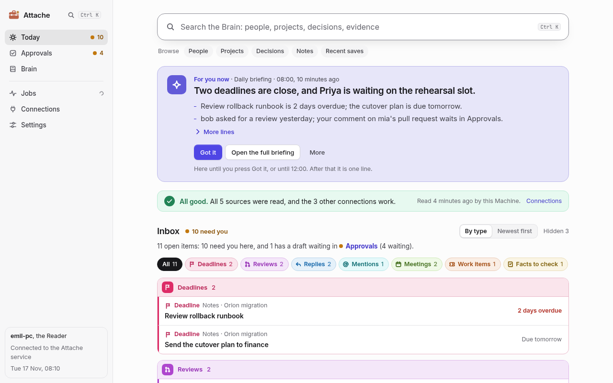

# Dashboard redesign - agreed scope

Two designers, Astra (GPT-6 Astra) and Fable (Claude Fable 5.2), designed the redesign independently and reviewed each other over three rounds.
After round 2 the owner gave feedback (`FEEDBACK-1.md`): too dense, too dull, item types blur together.
Fable produced v4 in response, Astra reviewed it in round 3, and Fable applied the agreed fixes as v5.
The owner then asked Fable directly for a look inspired by T3 Code and dropped the copper palette; that restyle is v6.

> **Superseded for the look (2026-11-18).**
> A GPT-6.2 Astra designer then designed the Dashboard blind, from the requirements only, in `../dashboard-blind-astra/`.
> The owner preferred it, and spec #14 and its tickets now take the visual language, the Home layout and the Inbox view from `../dashboard-blind-astra/DESIGN.md` and `../dashboard-blind-astra/SPEC-UPDATES.md`.
> This folder stays the reference for the counts, the Draft states, the fixtures and the narrow-screen journeys.
> `astra/review-4.md` is a GPT-6.2 Astra review of v6, and its findings are filed as #37 to #41.

## Where the design lives

| Topic | Authoritative file |
| --- | --- |
| Screens, colour, components, accessibility, phases | `fable/DESIGN.md` (v6), with `fable/prototype.html` and `fable/screenshots/` |
| The dot, the counts and the draft state machine | `fable/spec-dot-and-drafts.md` |
| Narrow layouts, keyboard model, conflicts, refused Revert, limited lists, the `heavy-day-v1` fixture | `astra/spec-states.md` |
| Owner feedback that shaped v4 and v5 | `FEEDBACK-1.md` |
| How the designers got there | `*/review-1.md`, `*/review-2.md`, `astra/review-3.md`, the "Changes in" sections of `fable/DESIGN.md` |
| Today's Dashboard, for comparison | `fable/current/` |

Open `fable/prototype.html` in a browser; the pill in the bottom right switches theme, time of day, service state, failed requests and the heavy-day fixture.

## The design in short

**Today** is the first screen, one centred column, top to bottom:

1. **Search the Brain.**
   A large field with results under it and quick links to People, Projects, Decisions, Notes and Recent saves.
   `Ctrl K` focuses it here and opens the same search as a palette on every other screen.
2. **For you now**, the proactive area.
   One lead card and up to two one-line followers in an indigo panel.
   In the morning it holds the daily briefing; from 15 minutes before a meeting it holds the meeting prep.
   Every card says why it is there and when it leaves, and the area shrinks to one line when nothing is timely.
   It is built as a slot of occupants, so new kinds of proactive content can be added as the Brain learns the owner.
3. **Connected services.**
   One green "All good" line when every source is positively known to work.
   Otherwise one row per problem: amber "Sign-in needed" with Reconnect, red "Down" with what failed and when, and honest "Not read yet", "Checking" and "Could not check" states; working services are never listed.
4. **Inbox.**
   Grouped by type, each type with its own hue, icon and word, shown as a left bar, a labelled kind and a tinted group header.
   Deadlines (rose), Reviews (purple), Replies (sky), Mentions (teal), Meetings (moss), Work items (orange), Facts to check (gold), System (slate).
   Type chips count and filter; "Newest first" gives one flat list where rows keep their type.
   An item whose draft waits for approval stays in its group with a "Draft waiting" tag.

**Approvals** is its own page, second in the navigation with its own count.
It holds "Drafts to send" and "Changes to the Brain" (Proposals), plus Finished, and replaces the Drafts screen and the Brain's Proposals subview.
Approve and Send stay on the draft's own page, with all fourteen draft states specified.

**The dot** on the logo, favicon and tab title still means one thing: something the owner can decide.
Today, Approvals and Connections each show their part, and the parts add up to the total.

**Look (v6)** follows T3 Code: zinc neutrals (near-white with white cards in light, near-black in dark), one typeface (Inter, system sans fallback), hairline borders, filled sidebar selection, a composer-style search field, and glass for search results, the palette and menus.
**Colour** is used actively: twelve hues with four steps each, all at 4.5:1 text and 3:1 non-text contrast in light and dark (lowest measured 4.63:1 and 3.12:1), always paired with an icon and a word.
Indigo is the single accent (links, primary buttons, focus, selection, Drafts) and is also the proactive panel's hue; the copper and brown palette and the serif are gone.
The brass attention dot is unchanged.

Kept from v3: Brain as a search-first library, nothing moving under the owner, no single-key irreversible actions, routed Settings with one "Machines and Replication" section, a bottom bar on narrow screens, and every current feature (`fable/DESIGN.md` section 12 maps where each one moves).

## Decisions after the spec interview (2026-11-18)

These come from the interview that turned this design into the spec, and override the design files where they differ.

- **Home, not Today.**
  The first screen is called Home and stays at `/`; "Inbox" names its section.
  Memory becomes Brain and Drafts becomes Approvals at new routes, with no redirects from the old ones; the `g` shortcuts follow the new names.
- **Words.**
  `GLOSSARY.md` now defines Inbox item, Draft and Heads-up (one thing in "For you now").
  Approvals is a page name only; "approve" keeps its narrow meaning for a Draft.
  The status area on Home is titled "Connections", not "Connected services".
- **Meeting prep.**
  A meeting prep Heads-up shows from 15 minutes before the start until the meeting's scheduled end; during the meeting it reads "In progress, ends ..." and leads with Join.
  Back to back, the next meeting's Heads-up appears 15 minutes before its start, below the one in progress; the order is the meeting in progress, the next meeting, then the briefing.
  The card links to the event in Google Calendar and to the Meet call.
  While it shows as a Heads-up, the item is not also listed in the Inbox, and it is counted once.
  The calendar Connection keeps the meeting prep item open until the scheduled end and carries the start, the end and the Meet link.
  Detecting from Google Meet when a call really ended moves to the proactive roadmap.
- **"Got it" and "Done".**
  The briefing's "Got it" is remembered per browser; meeting prep "Done" is the Inbox item's Done decision; "Not now" hides the Heads-up and leaves the item open.
- **Service work in the spec.**
  The bug fixes in PR #12 (a Draft's status on its Inbox item) and PR #13 (an ended approval returns to draft, and draft expiry is announced) cover C2, C3 and D1; the spec adds only the exact count route (C1) and the meeting prep change above.
- **Build.**
  One spec issue, one ticket per phase, built with `/implement-spec`, each phase merged to `main` with no feature flag, docs updated in the phase that changes them, Inter bundled and served locally.

## Bugs found in today's code

Both were verified by reading the code; neither has been reproduced end to end yet.

1. **An ended approval cannot be approved again.**
   After the 15-minute approval window, the draft stays `approved` and `executable` says "Approval expired; approve again", but `approve` refuses anything that is not `draft` or `revoked` (`apps/service/src/actions/service.ts:143`, `:197`).
2. **"View draft" outlives its draft.**
   `attention_items.action_id` is set when a draft is made and never cleared (`apps/service/src/actions/service.ts:76`), and the Inbox shows "View draft" whenever it is set (`apps/web/src/views/Inbox.tsx:95`).
   After a draft is rejected, expires or fails, the item can never offer "Prepare draft" again.

Also noted: `pnpm dev` fixes the Vite port at 5173 even when given `--port`, so two dev instances cannot run side by side.

## Owner decisions (2026-11-17)

1. **Naming and placement: confirmed.**
   The first screen is "Today" with "Inbox" as its section; Approvals covers drafts and Proposals; an item with a waiting draft stays in its type group with a "Draft waiting" tag.
2. **Service changes: as recommended.**
   The two bugs (D1 and C3) are fixed in their own PRs first.
   C1 (`GET /inbox/count`) and C2 (`actions.changed` on draft expiry) ship with the redesign.
   P1 to P7 and `nextRefreshAt` on `/reader` are the proactive area's own roadmap: P1 `GET /proactive` returning ranked occupants, P2 per-card feedback, P3 richer `meeting_prep` items, P4 lead-time settings, P5 "Got it" stored and replicated, P6 producers that read the Brain, P7 the day's briefings.
3. **Type hues: kept as they are.**
   Under red-green and blue-yellow simulation some hues come close (teal/slate, orange/gold, moss/gold, purple/sky); the icon and the word carry the type, and no retune is planned.
4. **The logo: kept as is,** copper and brass, as the one warm mark on the page; the attention dot keeps its colour.
5. **Indigo as both the accent and the "For you now" hue: kept.**

Still open, to settle while building: how long the briefing stays (until Got it or 12:00 is a guess); 2 Inbox rows above the fold at 1280 x 800 while the briefing is unread, 4 after (shrink the briefing card first if that is too few); a new draft from a finished one (deferred, "Copy text" is the bridge).

## Implementation phases

From `fable/DESIGN.md` section 11; each phase ships on its own and leaves the Dashboard whole.

0. **Foundations:** split `styles.css` into tokens, base, controls and per-screen files; zinc neutrals and the twelve hues with a contrast unit test; bundled Inter; `Tag`, `TypeIcon`, `AttentionDot`, icons; no-dot favicon.
1. **Shell and the dot:** `useNeedsYou()` with a unit test per row of the count table; new `Shell`, sidebar, bottom bar, machine foot; Today, Approvals and Brain in the navigation; `/approvals` route from day one.
2. **Today:** `BrainSearch`, `ServiceStatus` with a test per state, the proactive slot with a test per occupant against a fixed clock, the typed Inbox, request-failure states.
3. **Approvals and the draft's page:** the two groups and Finished; the fourteen-state draft model with a test per state.
4. **Brain and Jobs:** Library, note reader, fact list with source disclosure, search results, Recent saves; Jobs table and timeline.
5. **Connections, Settings, Setup:** connection rows, routed Settings sections, two-pane Setup.
6. **Palette and finish:** the `Ctrl K` palette, motion, screen reader, colour-vision, 320 px and 200% zoom passes, user guide and glossary updates, new visual captures.

Later, with the service: P1 moves the proactive occupants behind `GET /proactive`; P2 to P7 follow without changing the screen.
